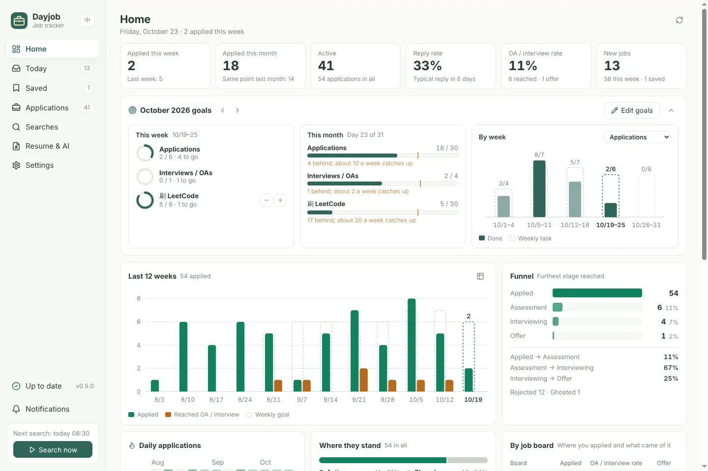
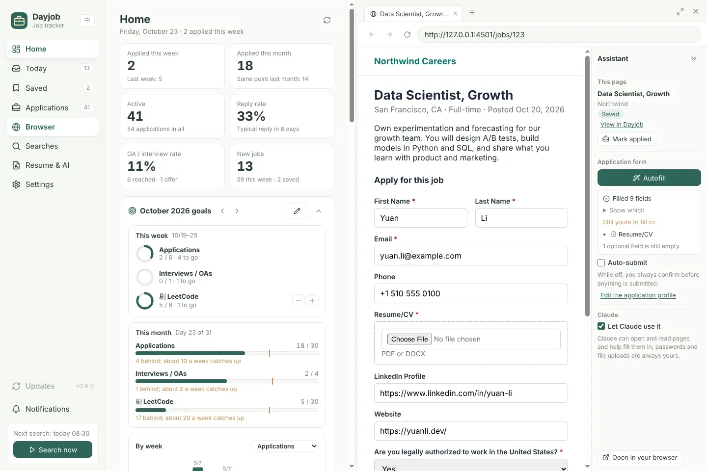

# Dayjob · Job tracker

[简体中文](README.md) · **English**

Dayjob fetches the jobs you want every day and scores each one against your resume with AI. Once you click "I applied", it keeps tracking the application: it reminds you to follow up, notices a long silence and checks whether the posting has closed. Everything is stored in a SQLite database on your computer.

Dayjob is the job-search mode of [Daylight](https://github.com/Key07211/daylight). It is developed as a separate project first and will be merged into Daylight, behind one button that switches between the two, once every feature is finished and verified.


> The companies, jobs and resume in the screenshots are made-up data from `scripts/seed-demo.mjs`. The interface follows the system's light or dark theme, or a theme you pick in Settings.

## Features

| Feature | What it does |
| --- | --- |
| Daily search | Runs every saved search at a set time (08:30 by default). If the computer was off, Dayjob catches up the next time it opens that day. "Search now" runs it any time. |
| Sources | LinkedIn and Indeed, requested directly the way JobSpy does it (no Python needed). Greenhouse, Lever and Ashby company boards through their official public JSON. Glassdoor, ZipRecruiter and Google Jobs through the optional Python JobSpy. |
| Job details | Title, company, location, remote, pay, job type and level, the full description, and the dates: **posted / opened**, first found by Dayjob, last seen in a search, last checked open. |
| Filters | Each search has keywords (comma-separated means any of them), location, a posted-within window, job type, remote only and words to exclude. The same job on several boards is merged. |
| AI scoring | Upload up to 3 PDF, Word or text resumes (one for data roles and one for software roles, say). Each job is scored 0–100 against the resume that shares the most keywords with it, with strengths, gaps and keywords you could add. It uses your signed-in Claude Code (`claude -p`, no API key) by default, or Codex signed in with your ChatGPT account, or your own Anthropic or OpenAI API key; you pick the model and the reasoning effort. Pause scoring at any time and resume later; remove every job under 60 in one click. |
| Suggestions | Under Searches, "Ask the AI" reads your resumes and suggests daily searches and companies worth following (each company board is checked first); add the ones you like in one click. |
| Application tracking | "I applied" records the date and a note and moves the job to Applications. Stages: Applied → Assessment → Interviewing → Offer / Accepted / Rejected / Withdrawn / Ghosted, each change on a timeline. Applications made elsewhere can be added by hand. |
| Automatic follow-through | A follow-up reminder N days (7 by default) after applying or a status change; a "possibly ghosted" flag after N days (21) at Applied; a daily check whether applied and saved jobs have closed. |
| Notifications | A daily summary (new jobs, strong matches), follow-up reminders and closed postings, as Windows notifications and in the app. |
| Running in the background | By default, closing the window leaves Dayjob in the tray, so searches, reminders and Claude keep working; "Quit Dayjob" in the tray menu closes it completely. To keep nothing running, untick "Keep running in the tray" under Settings → Closing the window: closing the window then quits Dayjob, and a missed daily search runs when you next open it that day. |
| Home | Dayjob opens on a statistics page: applications this week and month, reply rate, OA / interview rate, the monthly and weekly goals, the last 12 weeks, the funnel, a daily heatmap, where applications stand, results by job board, and what needs a follow-up, recent changes and the best matches not applied to yet. |
| Monthly goals | Set monthly targets for applications, interviews / OAs and goals of your own (practice problems, say); Dayjob splits them into weekly tasks and charts this week, the month so far and every week on Home. |
| Built-in browser | The desktop app has its own browser (Browser in the sidebar). It opens on the right, beside Home, Applications or any other page; drag it wider or let it fill the window. It has tabs, and its sign-ins stay on this computer. The assistant panel next to it shows where the job stands in Dayjob, with one click to add it to Dayjob or mark it applied. |
| Autofill / auto-submit | Fill in your name, email, phone, links and common answers once under Resume & AI → Application profile (it can read them from your resume). On an application form, click **Autofill** and Dayjob fills each empty box by its question, then lists the required fields still yours to fill in. With **Auto-submit** on, it submits as soon as every required field is filled (for this session of Dayjob only). |
| Claude MCP | Claude Code and Claude Desktop can read jobs and your resume, write back their own analysis, update applications, use the Dayjob browser (autofill included), read or set monthly goals and read the Home statistics, with 34 tools. |
| Automatic updates | The installed app checks GitHub Releases for a new version once a day (you can turn this off in Settings), and "Check for updates" in the sidebar checks any time. When one is out it turns into a round download button; once downloaded, click "Restart to update". |
| 中文 / English | Switch with the EN / 中 button at the top left or under Settings → Language. Notifications and the tray menu follow; the AI analysis language is set separately under Resume & AI. |
| Motion | Jobs waiting to be scored shimmer, each score pops in and counts up, and a bar at the bottom left shows scoring progress; new jobs slide in one after another, jobs glide to their new place when the order changes, and removed low matches fade out row by row; the sidebar highlight slides between pages and the browser slides in from the right. Dayjob follows Windows' Animation effects setting by default; pick On or Reduced under Settings → Motion. |


## Download

Download the latest Windows version:

- **[Installer (Dayjob-Setup.exe)](https://github.com/Key07211/dayjob---job-tracker/releases/latest/download/Dayjob-Setup.exe)**: open Dayjob from the Start menu or the desktop shortcut afterwards.
- **[Portable (Dayjob-Portable.exe)](https://github.com/Key07211/dayjob---job-tracker/releases/latest/download/Dayjob-Portable.exe)**: runs without installing.

Each version's notes, the same files with the version in their names (`Dayjob-Setup-x.y.z.exe`, `Dayjob-Portable-x.y.z.exe`) and a SHA-256 checksum file are on the [Releases](https://github.com/Key07211/dayjob---job-tracker/releases/latest) page.

The programs are not signed yet, so the first time Windows may say "Windows protected your PC"; click "More info", then "Run anyway". From 0.3.0 the installed app updates itself ("Check for updates" in the sidebar); for the portable app, the download button gets the new portable app in your browser. Version 0.2.0 and earlier need 0.3.0 downloaded and installed over them once. Upgrading or uninstalling keeps your data in `%APPDATA%\Dayjob`.

## Run from source

Needs Node.js 22.13 or newer (for the built-in `node:sqlite`).

```bash
npm install
npm run build
npm start            # opens on http://127.0.0.1:4318
```

The desktop app (tray, desktop notifications, one-click Claude connection):

```bash
npm run desktop:preview   # builds the interface and opens it in Electron
npm run package:win       # Windows installer and portable build in release/
```

`npm run dev` serves the interface with hot reload on port 5174 and forwards `/api` to 4318.

### Where the data lives

| How you run it | Database |
| --- | --- |
| Desktop app | `%APPDATA%\Dayjob\data\dayjob.sqlite` |
| `npm start` | `data/dayjob.sqlite` in the project (git-ignored) |
| Custom | set `DAYJOB_DATA_DIR`; the port is `DAYJOB_PORT` |

Only the text extracted from your resume is stored, never the file. A Claude API key is stored in plain text in the local database and is never sent back to the interface or the API; you can use the `ANTHROPIC_API_KEY` environment variable instead.

## First steps

1. **Resume & AI**: upload your resume (up to 3), then click **Read from my resume** under **Application profile** below and fill in what it missed; autofill uses it. To score with Claude Code, install it, run `claude` in a terminal and type `/login`. If it is not signed in, the Resume & AI page says so; click "Check again" after signing in.
2. **Searches**: click **Ask the AI** and add the searches and companies you like from its suggestions, or add a search yourself, for example keywords `data scientist, machine learning engineer`, location `San Francisco Bay Area`, sources LinkedIn and Indeed, posted in the past 3 days. To follow a company, paste its careers link (`boards.greenhouse.io/…`, `jobs.lever.co/…`, `jobs.ashbyhq.com/…`); every open job there that matches a search's keywords and location is kept, however long ago it was posted.
3. Click **Search now** at the bottom left. By default jobs are scored when the search finishes; to save Claude allowance, switch Resume & AI to score only the jobs you save, or only when you ask.
4. Browse **Today**, save jobs or mark them not interested. To apply, click "Company apply page" in a job's details; it opens in the browser on the right, where **Autofill** fills in the application form. After applying, click **I applied** (or **Mark applied** in the browser's assistant panel); everything after that happens in **Applications**.
5. Come back to **Home** for the overall picture: how much you have applied, what needs a follow-up and which strong matches are still waiting.

## AI scoring

| Option | Notes |
| --- | --- |
| Claude Code on this computer (default) | Runs `claude -p` on your Claude plan; no API key. If `claude` is not found, enter its full path under Resume & AI. |
| Claude API | Your own Anthropic API key, default model `claude-opus-5-5`, billed by usage. Server-side fallback is on for models that have it, such as Opus, Fable and Sonnet 5.5: if the chosen model declines a request, Anthropic retries it once with a fallback model. |
| Codex on this computer (ChatGPT) | Runs `codex exec` on the Codex allowance of your ChatGPT plan; no API key. Install Codex, run `codex` in a terminal and choose Sign in with ChatGPT. Codex runs in a read-only sandbox from an empty folder, without your Codex config or MCP servers. |
| OpenAI API | Your own OpenAI API key (Responses API), default model `gpt-6.1-sol`, billed by usage; requests are not stored by OpenAI. |
| Claude through MCP | Ask Claude Code or Claude Desktop to "analyse this job against my resume"; Claude reads both and saves the result with `dayjob_save_analysis`. |

### Model and reasoning effort

Once you pick a provider under **AI scoring** in Resume & AI, the **Model** list shows that provider's models, and **Reasoning effort** lists only the levels the chosen model accepts:

| Provider | Models |
| --- | --- |
| Claude Code / Claude API | Claude Opus 5.5 (recommended), Fable 5.1 (most capable), Sonnet 5.5, Haiku 5.5 (fast, cheap), and older Fable 5, Opus 5, Sonnet 5, Opus 4.8 / 4.7 / 4.6, Sonnet 4.6 and Haiku 4.5. Claude Code also offers "Claude Code's own setting" (the default). |
| Codex | GPT-6.1 Sol (recommended), GPT-6 Astra (most capable), GPT-6 Sol, GPT-6 Luna (fast, cheap), or "Codex's own setting". On ChatGPT Free and Go, Codex offers GPT-6 Luna only. |
| OpenAI API | The four GPT-6 models above, plus GPT-5.6 Sol / Terra / Luna, GPT-5.5 and GPT-5 mini. |

For a model not in the list, choose "Other (type a model id)". Reasoning effort runs Low / Medium / High / Extra high / Max and starts at "Model default". Higher looks closer at each job, but is slower and uses more; Haiku 4.5 has no such setting. Switching models resets a level the new model lacks to "Model default". Upgrading changes nothing about how jobs are scored: Claude Code stays on its own model and effort, and the Claude API keeps its model and level.

Each scored job is one AI call and uses your Claude Code or Codex allowance (or API credit). Pick when it happens under **When to score** in Resume & AI:

| Option | When jobs are scored |
| --- | --- |
| After every search (default) | Each run scores up to 40 jobs (adjustable): new jobs first, then older unscored ones. |
| Only jobs I save | A job is scored when you save it; searches only catch up on saved jobs that are still unscored. |
| Only when I ask | Click **Score with AI** on a job, or tick a few in Today and click **Score N picked jobs** at the top right. |

If you had turned off "Score after each search" in 0.2.0 or earlier, you get "Only when I ask" after updating.

While scoring runs, the bottom left shows "AI is scoring 3/12" and a **Pause scoring** button. Pausing stops the job being scored at once (the Claude Code or Codex process ends too, so it uses no more allowance) and keeps the rest waiting; new jobs from searches and scores you ask for wait as well. **Resume scoring** carries on, skipping jobs you have since marked not interested or applied to. Dayjob stays paused after a restart.

**Remove jobs under 60** at the top right of **Today** moves every new job scoring under 60 to Not interested in one go. Saved, applied and unscored jobs stay. Click **Undo** right after to bring them back.

With several resumes, Dayjob first compares each job's keywords with each resume on your computer (title words count more; words every posting has, such as "experience", "team" and equal-opportunity text, are ignored) and sends the best-matching resume to the AI. A job's details show which resume was used, the shared keywords and every resume's overlap. After you add or delete a resume, jobs pick their resume again, and a job whose resume changed is scored again.

## Search and company suggestions

On **Searches**, click **Ask the AI** (optionally with preferences such as "Bay Area or remote only, needs H-1B sponsorship"). The AI runs with the provider and model chosen under Resume & AI (Claude Code or Codex on this computer uses your allowance; it takes about a minute) and, after reading all your resumes, suggests:

- up to 6 searches: job-title keywords, location, level words to exclude (Senior and Staff for a new-grad resume, for example) and which resume each fits;
- up to 10 companies, only ones that hire through Greenhouse, Lever or Ashby. Dayjob requests each board, drops those that do not exist and shows how many jobs are open.

Nothing is added until you click **Add** or **Follow**; you can also edit a search before adding it. When you are done, click **Done, close the suggestions** at the bottom (or the ✕ at the top) to put them away. The latest suggestions are kept: click **Show them again** to bring them back, and new suggestions open on their own.

## Home

Dayjob opens on **Home**, which puts applications, tracking and goals on one page:



| Part | What it shows |
| --- | --- |
| Numbers at the top | Applied this week (and last week), this month (and the same point last month), active applications, reply rate and the typical days to a reply, the share that reached an OA or interview and the offers, and new jobs to look at. |
| Monthly goals | This week's tasks, the month so far and every week; see the next section. |
| Last 12 weeks | Applications each week (green) and OAs / interviews reached (orange); the dashed boxes are the weekly application goal. Hover a week for its numbers, or switch to a table at the top right. |
| Funnel | The furthest stage each application reached: applied → assessment → interview → offer, with each step's conversion. An application rejected later still counts at the stage it reached. |
| Daily applications | How many you sent each day over 12 weeks (darker is more), and your current streak. |
| Where they stand | How many applications are active or closed, and in which status. |
| By job board | How many you applied to through LinkedIn, Indeed, company boards and so on, how many reached an OA or interview, and the offers. Applications added by hand get their own row. |
| Needs a follow-up / Recent changes / Best matches | Click a row to open that application or job. |

## Monthly goals

**Home** shows this month's goals. Click **Set goals** and fill in how many you want this month:

| Goal | How it is counted |
| --- | --- |
| Applications | Automatically, by applied date, when you mark a job applied or add an application by hand. |
| Interviews / OAs | Automatically, when an application moves to Assessment or Interviewing; an application's assessment and interview count once each. |
| Custom (practice problems, coffee chats…) | By you: click **+1** under This week, or **−1** to take a mistake back. |

Weeks run Monday to Sunday; the partial weeks at the start and end of the month count by their days. Each week's task is the monthly target times that week's share of the month's days, rounded so the weeks add up to the target exactly. For 40 applications in October 2026, the weekly tasks are 5 · 9 · 9 · 9 · 8.

- **This week**: how many each goal has this week, and how many are left.
- **This month**: done against the target; the orange line is where you would be today at an even pace. When you are behind it says about how many a week catch up.
- **By week**: bars are what you did each week, dashed boxes are the weekly tasks.

The arrows show the previous month or let you set next month's goals early. A new month starts with last month's goals (progress starts at 0); change or clear them as you like. Hide the panel with the arrow at its top right.

## Connect Claude (MCP)

Desktop installer: **Settings → Connect Claude** adds Dayjob to Claude Code (`~/.claude.json`) and Claude Desktop, backing up each file first and touching only the `dayjob` entry.

From source, run this in a terminal (with your Dayjob folder):

```bash
claude mcp add dayjob -s user -e DAYJOB_URL=http://127.0.0.1:4318 -- node <Dayjob folder>/integrations/mcp-server.mjs
```

Dayjob needs to be running. Then try:

> Which jobs in Dayjob scored 80 or more today? Sort them by match.
>
> I just applied to the Data Scientist role at Lumen Health. Mark it as applied in Dayjob.
>
> Update my Dayjob applications from the interview invites in my Gmail.

| Tool | Purpose |
| --- | --- |
| `dayjob_status` | State, next daily run, resume and scoring status |
| `dayjob_list_postings` / `dayjob_get_posting` | Find jobs (by score, source, time) and read one |
| `dayjob_list_resumes` / `dayjob_get_resume` | List the resumes; read the one a job is matched to (or a given one) |
| `dayjob_save_analysis` / `dayjob_score_posting` | Save Claude's own analysis, run the scorer |
| `dayjob_set_posting_status` / `dayjob_add_posting` | Save or dismiss a job, add one by hand |
| `dayjob_mark_applied` / `dayjob_add_application` | Mark a job as applied, add an application made elsewhere |
| `dayjob_list_applications` / `dayjob_get_application` / `dayjob_update_application` | Read and update stages, notes and follow-up dates |
| `dayjob_list_searches` / `dayjob_save_search` / `dayjob_follow_company` / `dayjob_run_search` | Manage searches, follow companies, search now |
| `dayjob_list_notifications` | Recent reminders |
| `dayjob_get_goals` / `dayjob_set_goal` / `dayjob_log_goal_progress` | Read monthly goals and weekly tasks, set a goal, log a custom goal |
| `dayjob_get_dashboard` | Read the Home statistics (weekly applications, the funnel, reply rate, results by board, applications that need a follow-up…), handy for a weekly review with Claude |
| `dayjob_browser_open` / `dayjob_browser_read` / `dayjob_browser_screenshot` | Open a page in the Dayjob browser, read its text and the elements to act on, take a screenshot |
| `dayjob_browser_click` / `dayjob_browser_type` / `dayjob_browser_select` / `dayjob_browser_press_key` | Click, type, pick a dropdown option, press a key |
| `dayjob_browser_scroll` / `dayjob_browser_navigate` / `dayjob_browser_tabs` | Scroll, go back, forward or reload, switch and close tabs |
| `dayjob_browser_autofill` | Fill the open application form from the application profile (same as Autofill in the assistant panel) and tell Claude what was filled and which required fields are left; it never submits |

Changes made through MCP show as "Claude" on the timeline.

## Built-in browser

**Browser** in the desktop app's sidebar is Dayjob's own browser, separate from Chrome and Edge. It opens on the right side of the window and the page you were on stays on the left, so you can read a job and keep notes at the same time:



- Drag the divider between the two to change the width (double-click resets it; the left and right arrow keys work too). The buttons at the top right switch between **Fill the window** and **Show beside the current page**, and × hides the browser while keeping its tabs. In a narrow window it always fills the window.
- Sign in to LinkedIn, Indeed, Handshake or company career sites there. Sign-ins and cookies stay in Dayjob's data on this computer (**Settings → Dayjob browser** clears them).
- "Open on LinkedIn" and "Company apply page" in a job's details open there; **Open in your browser** at the bottom of the assistant panel opens the page in Chrome or Edge.

The **Assistant** panel sits to the right of the page (`»` folds it into a thin strip):

| Part | What it does |
| --- | --- |
| This page | When the page is already in Dayjob, it shows the title, company and status, with **View in Dayjob** and **Mark applied**. Otherwise click **Add to Dayjob**: it reads the page's standard job data (schema.org JobPosting, which most job sites publish) or its text, and after you check it, saves the job, or **Save and mark applied** in one go. |
| Autofill | Reads each question on the form and fills the empty boxes from your **Application profile**: name, email, phone, address, LinkedIn / GitHub / website, school and work, work authorization, sponsorship, relocation, desired salary, earliest start date, where you heard about the job and more, including dropdowns and radio buttons. Boxes that already have an answer are left alone. Afterwards it lists what it filled and the required fields still yours to fill in (such as the resume upload). Forms embedded from another site, like a Greenhouse form on a company's own page, work too. |
| Auto-submit | Off by default; while it is off, nothing is submitted unless you click it or allow it. Turning it on asks once more. While it is on, Autofill clicks Submit as soon as every required field is filled and checks that the page says the application was received, and Claude's clicks on Submit no longer ask first. It turns off again every time Dayjob starts. After a submit, click **Mark applied** and the job moves to Applications. |
| Claude | Untick **Let Claude use it** and Claude can no longer open or use the browser. |

Autofill never touches passwords, one-time codes, signatures, references or emergency contacts. Voluntary self-identification questions (gender, race, veteran, disability) are answered "decline to answer" by default; untick that in the application profile and they are left for you. The profile stays on this computer.

With Claude connected, try:

> Open this job's application page in the Dayjob browser, autofill it, answer the remaining questions from my resume, and show me before you submit.

What Claude can and cannot do there:

- It can open pages, read them, take screenshots, click, type, pick dropdown options and switch tabs, and fill in your profile first with `dayjob_browser_autofill`. You see it happen in the Dayjob window ("Claude is working").
- Clicking a button such as Submit, Send, Confirm or Delete, or pressing Enter in a multi-field form, first asks you in Dayjob. Nothing happens until you click **Allow**, and the request is dropped after 2 minutes. Only while you have **Auto-submit** on does it go ahead straight away, and Claude is told so.
- It never types passwords, card numbers or one-time codes, and it does not upload files; you choose the resume yourself. Text on web pages is treated as data, never as instructions.

Some sites do not allow signing in with Google inside an app's browser. Sign in with email and password there, or click **Open in your browser**.

## JobSpy (optional)

Glassdoor, ZipRecruiter and Google Jobs need the Python [JobSpy](https://github.com/speedyapply/JobSpy):

```bash
pip install python-jobspy
```

Then check the Python command under **Settings → JobSpy** (`python` on Windows by default) and save to detect it again. LinkedIn, Indeed and company boards do not need Python.

## About scraping

- LinkedIn and Indeed limit frequent requests. Dayjob waits a few random seconds between pages and backs off on HTTP 429; when a site limits it, that run is marked partly succeeded and the other sources carry on. One run a day with a few dozen results per search is usually fine; avoid short intervals or hundreds of results at once.
- When checking whether jobs have closed, a job that today's search still lists counts as open and is not requested again. Some networks are refused Indeed's job pages (HTTP 401); then Dayjob cannot tell whether an Indeed job has closed, only whether it still shows up in searches. Other sources are checked as usual.
- Glassdoor, ZipRecruiter and Google Jobs rely on JobSpy, which may need updating when those sites change.
- Follow each site's terms of use and use Dayjob for your own job search only.

To check every source from your network:

```bash
npm run live-check                          # LinkedIn, Indeed, Greenhouse, Lever, Ashby
npm run live-check -- --pipeline            # plus a full run into a temporary database
npm run live-check -- --score resume.pdf    # plus one Claude Code score
npm run live-check -- --jobspy              # plus the Python JobSpy
```

## Tests

```bash
npm test
```

The tests never touch a real site: scrapers read saved pages (`tests/fixtures/`), scoring uses fake providers and MCP an in-memory connection.

The desktop smoke test (`electron . --smoke-test <result.json>`, run on every Windows build) also opens a local application form in the built-in browser (part of it inside an iframe from another origin), autofills it and checks every value, checks that a second run leaves the filled answers alone, checks that Claude clicking Submit asks the user first, and that with auto-submit on, Autofill submits the form and recognizes the "application received" page. For the installed app it also serves a pretend "9.9.9" release from this computer, checks that the sidebar shows the round download button, then clicks it and downloads and verifies the installer (without installing it).

To try the interface without scraping, generate made-up data:

```bash
node scripts/seed-demo.mjs ./demo-data
DAYJOB_DATA_DIR=./demo-data npm start
```

## Releasing

For every pull request and every push to main, GitHub Actions runs the tests on Windows, builds the installer and the portable app, and starts each form (unpacked, silently installed and portable), including the packaged Claude MCP connection.

To release, change `version` in `package.json` (for example to `0.2.0`) and merge to main. If that version has not been released yet, the workflow publishes the files it just verified as release `v0.2.0`. There is no tag to push, and releases are never published by hand on GitHub.

To check a build on your own computer:

```bash
npm run package:win
powershell -ExecutionPolicy Bypass -File scripts/verify-windows-build.ps1 -Version 0.7.0
```

## License notes

The scrapers follow [JobSpy](https://github.com/speedyapply/JobSpy) (MIT); see [THIRD_PARTY_NOTICES.md](THIRD_PARTY_NOTICES.md).
