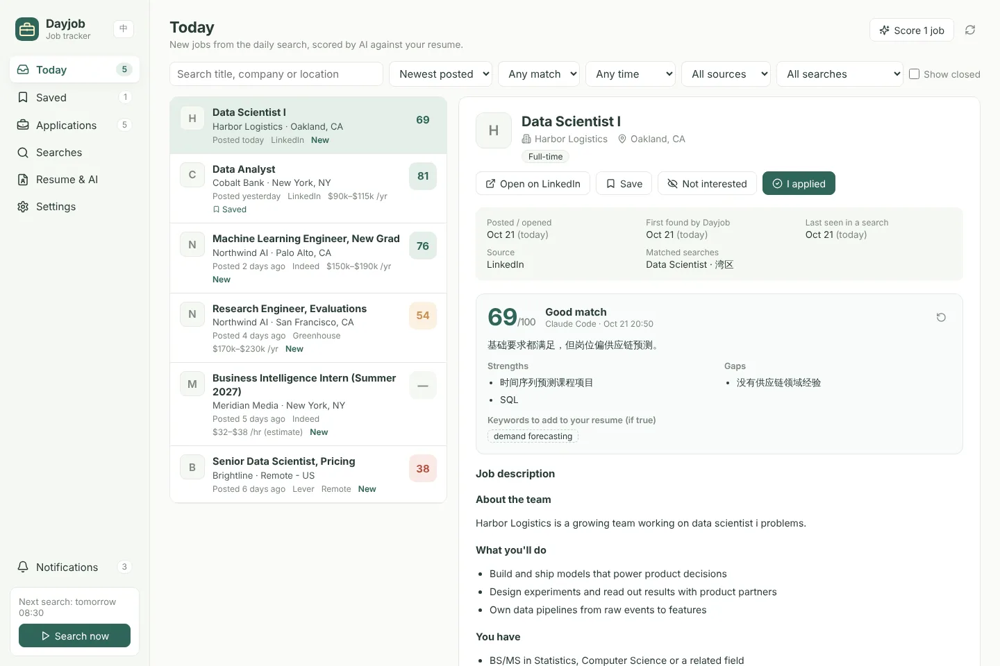
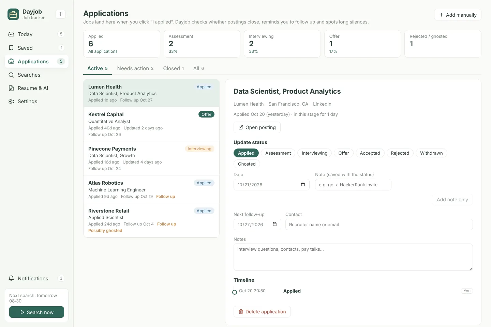

# Dayjob · Job tracker

[简体中文](README.md) · **English**

Dayjob fetches the jobs you want every day and scores each one against your resume with AI. Once you click "I applied", it keeps tracking the application: it reminds you to follow up, notices a long silence and checks whether the posting has closed. Everything is stored in a SQLite database on your computer.

Dayjob is the job-search mode of [Daylight](https://github.com/Key07211/daylight). It is developed as a separate project first and will be merged into Daylight, behind one button that switches between the two, once every feature is finished and verified.



> The companies, jobs and resume in the screenshots are made-up data from `scripts/seed-demo.mjs`. The interface follows the system's light or dark theme, or a theme you pick in Settings.

## Features

| Feature | What it does |
| --- | --- |
| Daily search | Runs every saved search at a set time (08:30 by default). If the computer was off, Dayjob catches up the next time it opens that day. "Search now" runs it any time. |
| Sources | LinkedIn and Indeed, requested directly the way JobSpy does it (no Python needed). Greenhouse, Lever and Ashby company boards through their official public JSON. Glassdoor, ZipRecruiter and Google Jobs through the optional Python JobSpy. |
| Job details | Title, company, location, remote, pay, job type and level, the full description, and the dates: **posted / opened**, first found by Dayjob, last seen in a search, last checked open. |
| Filters | Each search has keywords (comma-separated means any of them), location, a posted-within window, job type, remote only and words to exclude. The same job on several boards is merged. |
| AI scoring | Upload a PDF, Word or text resume. AI rates every job 0–100 and lists strengths, gaps and keywords you could add to your resume. It uses your signed-in Claude Code (`claude -p`, no API key) by default, or your own Anthropic API key. |
| Application tracking | "I applied" records the date and a note and moves the job to Applications. Stages: Applied → Assessment → Interviewing → Offer / Accepted / Rejected / Withdrawn / Ghosted, each change on a timeline. Applications made elsewhere can be added by hand. |
| Automatic follow-through | A follow-up reminder N days (7 by default) after applying or a status change; a "possibly ghosted" flag after N days (21) at Applied; a daily check whether applied and saved jobs have closed. |
| Notifications | A daily summary (new jobs, strong matches), follow-up reminders and closed postings, as Windows notifications and in the app. |
| Claude MCP | Claude Code and Claude Desktop can read jobs and your resume, write back their own analysis and update applications, with 18 tools. |
| 中文 / English | Switch with the EN / 中 button at the top left or under Settings → Language. Notifications and the tray menu follow; the AI analysis language is set separately under Resume & AI. |



## Download

Get the latest Windows version from [Releases](https://github.com/Key07211/dayjob---job-tracker/releases/latest):

| File | What it is |
| --- | --- |
| `Dayjob-Setup-x.y.z.exe` | The installer. Open Dayjob from the Start menu or the desktop shortcut. |
| `Dayjob-Portable-x.y.z.exe` | Runs without installing. |
| `SHA256SUMS-x.y.z.txt` | SHA-256 checksums of both files. |

The programs are not signed yet, so the first time Windows may say "Windows protected your PC"; click "More info", then "Run anyway". New versions are downloaded by hand and installed over the old one; upgrading or uninstalling keeps your data in `%APPDATA%\Dayjob`.

## Run from source

Needs Node.js 22.13 or newer (for the built-in `node:sqlite`).

```bash
npm install
npm run build
npm start            # opens on http://127.0.0.1:4318
```

The desktop app (tray, desktop notifications, one-click Claude connection):

```bash
npm run desktop:preview   # builds the interface and opens it in Electron
npm run package:win       # Windows installer and portable build in release/
```

`npm run dev` serves the interface with hot reload on port 5174 and forwards `/api` to 4318.

### Where the data lives

| How you run it | Database |
| --- | --- |
| Desktop app | `%APPDATA%\Dayjob\data\dayjob.sqlite` |
| `npm start` | `data/dayjob.sqlite` in the project (git-ignored) |
| Custom | set `DAYJOB_DATA_DIR`; the port is `DAYJOB_PORT` |

Only the text extracted from your resume is stored, never the file. A Claude API key is stored in plain text in the local database and is never sent back to the interface or the API; you can use the `ANTHROPIC_API_KEY` environment variable instead.

## First steps

1. **Resume & AI**: upload your resume. To score with Claude Code, install it, run `claude` in a terminal and type `/login`. If it is not signed in, the Resume & AI page says so; click "Check again" after signing in.
2. **Searches**: add a search, for example keywords `data scientist, machine learning engineer`, location `San Francisco Bay Area`, sources LinkedIn and Indeed, posted in the past 3 days. To follow a company, paste its careers link (`boards.greenhouse.io/…`, `jobs.lever.co/…`, `jobs.ashbyhq.com/…`); every open job there that matches a search's keywords and location is kept, however long ago it was posted.
3. Click **Search now** at the bottom left. Jobs are scored when the search finishes.
4. Browse **Today**, save jobs or mark them not interested. After applying, click **I applied**; everything after that happens in **Applications**.

## AI scoring

| Option | Notes |
| --- | --- |
| Claude Code on this computer (default) | Runs `claude -p` on your Claude plan; no API key. If `claude` is not found, enter its full path under Resume & AI. |
| Claude API | Your own API key, default model `claude-opus-5-5`, billed by usage. Server-side fallback is on: if the chosen model declines a request, Anthropic retries it once with a fallback model. |
| Claude through MCP | Ask Claude Code or Claude Desktop to "analyse this job against my resume"; Claude reads both and saves the result with `dayjob_save_analysis`. |

Each run scores up to 40 jobs (adjustable): new jobs first, then older unscored ones. Switching resumes scores jobs again against the new one.

## Connect Claude (MCP)

Desktop installer: **Settings → Connect Claude** adds Dayjob to Claude Code (`~/.claude.json`) and Claude Desktop, backing up each file first and touching only the `dayjob` entry.

From source, run this in a terminal (with your Dayjob folder):

```bash
claude mcp add dayjob -s user -e DAYJOB_URL=http://127.0.0.1:4318 -- node <Dayjob folder>/integrations/mcp-server.mjs
```

Dayjob needs to be running. Then try:

> Which jobs in Dayjob scored 80 or more today? Sort them by match.
>
> I just applied to the Data Scientist role at Lumen Health. Mark it as applied in Dayjob.
>
> Update my Dayjob applications from the interview invites in my Gmail.

| Tool | Purpose |
| --- | --- |
| `dayjob_status` | State, next daily run, resume and scoring status |
| `dayjob_list_postings` / `dayjob_get_posting` | Find jobs (by score, source, time) and read one |
| `dayjob_get_resume` / `dayjob_save_analysis` / `dayjob_score_posting` | Read the resume, save Claude's own analysis, run the scorer |
| `dayjob_set_posting_status` / `dayjob_add_posting` | Save or dismiss a job, add one by hand |
| `dayjob_mark_applied` / `dayjob_add_application` | Mark a job as applied, add an application made elsewhere |
| `dayjob_list_applications` / `dayjob_get_application` / `dayjob_update_application` | Read and update stages, notes and follow-up dates |
| `dayjob_list_searches` / `dayjob_save_search` / `dayjob_follow_company` / `dayjob_run_search` | Manage searches, follow companies, search now |
| `dayjob_list_notifications` | Recent reminders |

Changes made through MCP show as "Claude" on the timeline.

## JobSpy (optional)

Glassdoor, ZipRecruiter and Google Jobs need the Python [JobSpy](https://github.com/speedyapply/JobSpy):

```bash
pip install python-jobspy
```

Then check the Python command under **Settings → JobSpy** (`python` on Windows by default) and save to detect it again. LinkedIn, Indeed and company boards do not need Python.

## About scraping

- LinkedIn and Indeed limit frequent requests. Dayjob waits a few random seconds between pages and backs off on HTTP 429; when a site limits it, that run is marked partly succeeded and the other sources carry on. One run a day with a few dozen results per search is usually fine; avoid short intervals or hundreds of results at once.
- When checking whether jobs have closed, a job that today's search still lists counts as open and is not requested again. Some networks are refused Indeed's job pages (HTTP 401); then Dayjob cannot tell whether an Indeed job has closed, only whether it still shows up in searches. Other sources are checked as usual.
- Glassdoor, ZipRecruiter and Google Jobs rely on JobSpy, which may need updating when those sites change.
- Follow each site's terms of use and use Dayjob for your own job search only.

To check every source from your network:

```bash
npm run live-check                          # LinkedIn, Indeed, Greenhouse, Lever, Ashby
npm run live-check -- --pipeline            # plus a full run into a temporary database
npm run live-check -- --score resume.pdf    # plus one Claude Code score
npm run live-check -- --jobspy              # plus the Python JobSpy
```

## Tests

```bash
npm test
```

The tests never touch a real site: scrapers read saved pages (`tests/fixtures/`), scoring uses fake providers and MCP an in-memory connection.

To try the interface without scraping, generate made-up data:

```bash
node scripts/seed-demo.mjs ./demo-data
DAYJOB_DATA_DIR=./demo-data npm start
```

## Releasing

For every pull request and every push to main, GitHub Actions runs the tests on Windows, builds the installer and the portable app, and starts each form (unpacked, silently installed and portable), including the packaged Claude MCP connection.

To release, change `version` in `package.json` (for example to `0.2.0`) and merge to main. If that version has not been released yet, the workflow publishes the files it just verified as release `v0.2.0`. There is no tag to push, and releases are never published by hand on GitHub.

To check a build on your own computer:

```bash
npm run package:win
pwsh scripts/verify-windows-build.ps1 -Version 0.2.0
```

## License notes

The scrapers follow [JobSpy](https://github.com/speedyapply/JobSpy) (MIT); see [THIRD_PARTY_NOTICES.md](THIRD_PARTY_NOTICES.md).
