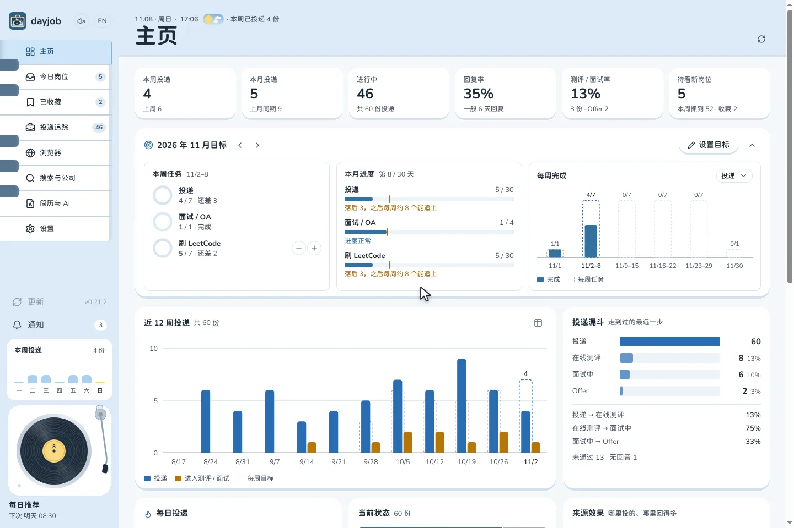
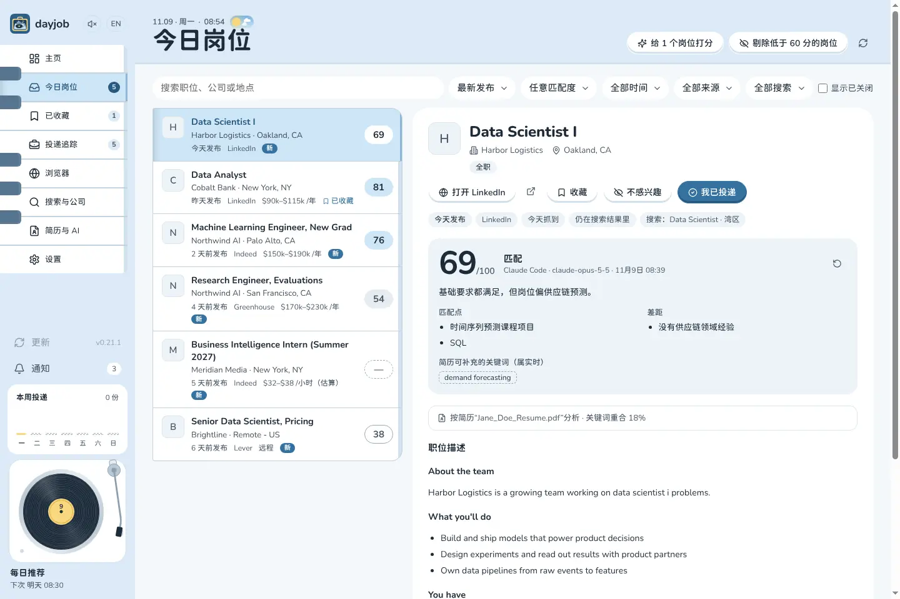
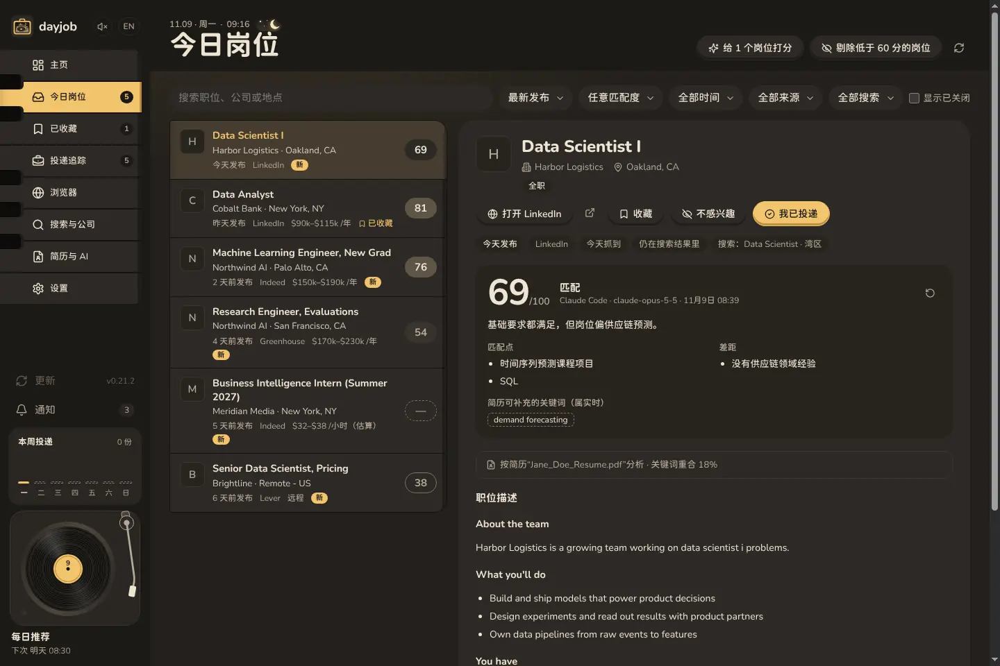
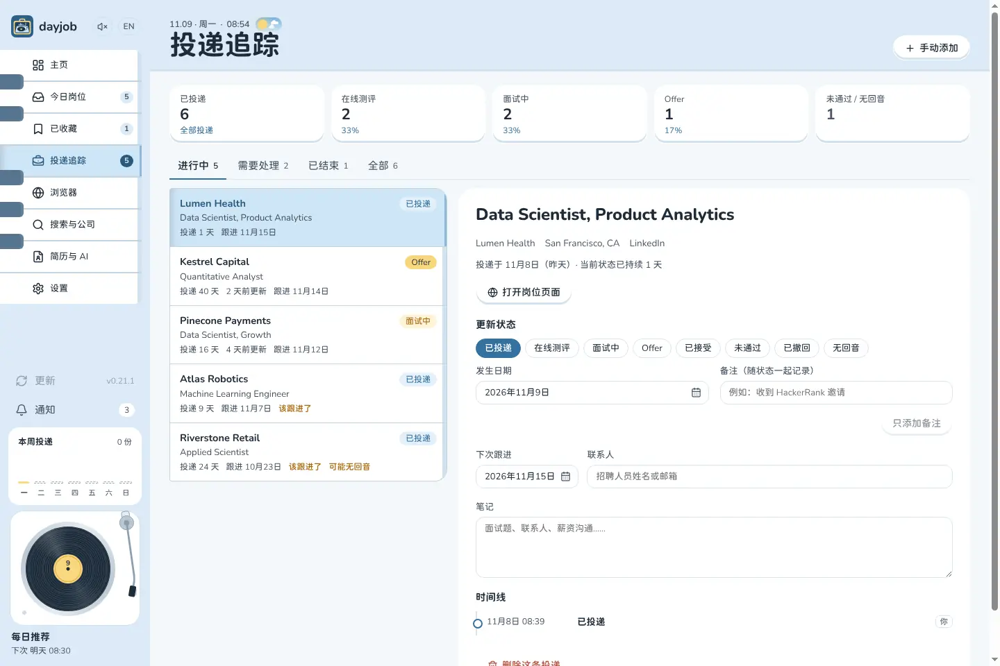
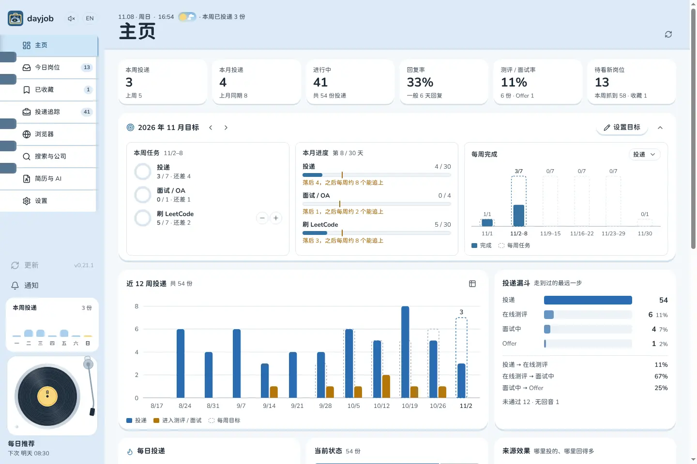
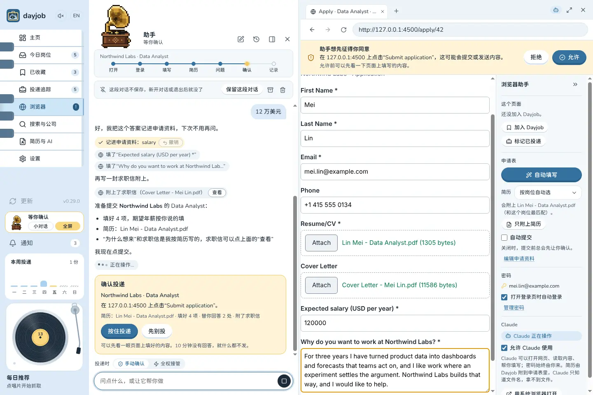
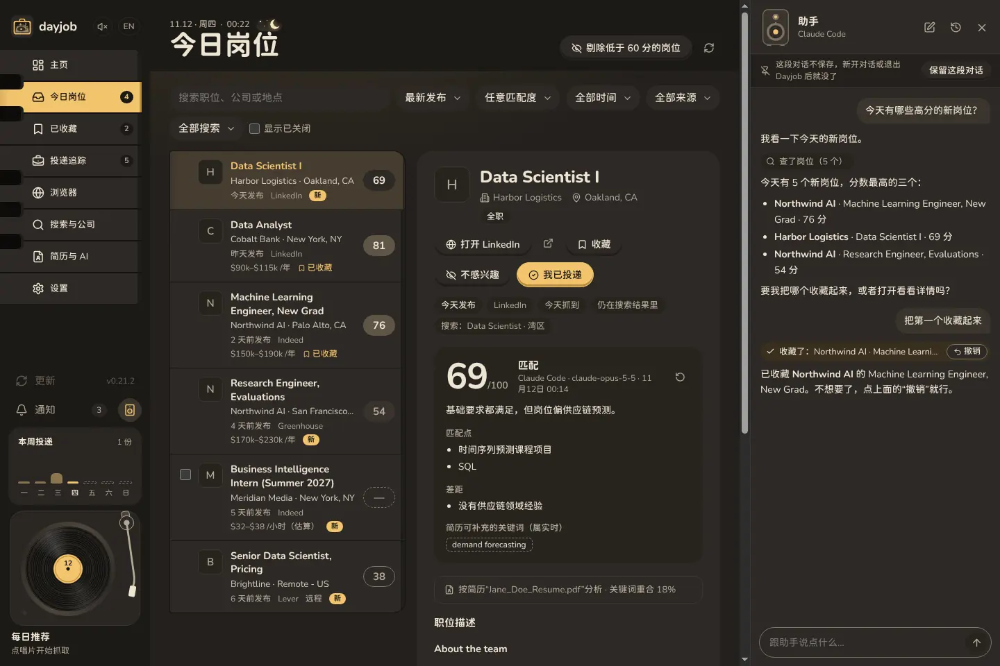
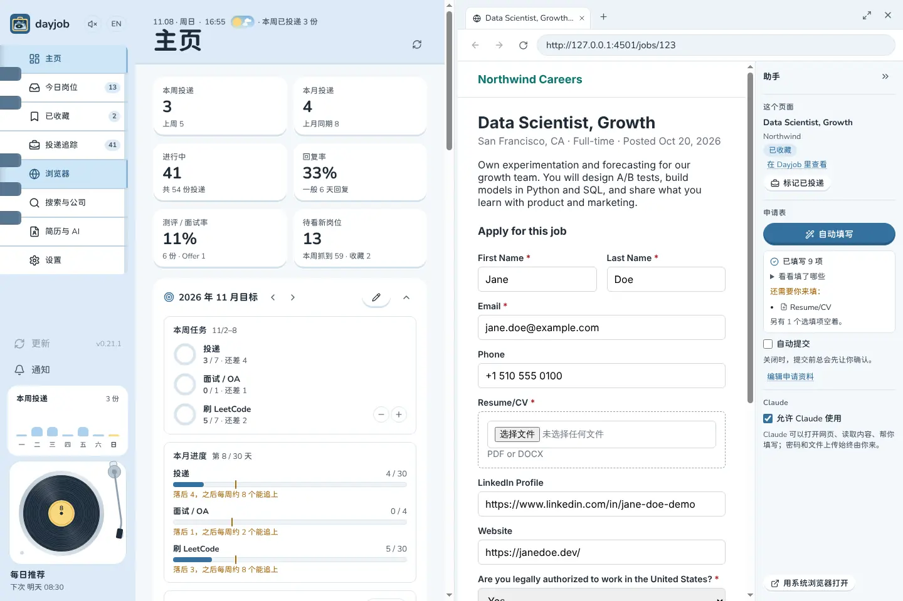

# Dayjob · 求职追踪

**简体中文** · [English](README.en.md)

每天自动抓取你想要的岗位，按你的简历用 AI 打分；点“我已投递”之后，Dayjob 会接着追踪这份申请：提醒跟进、发现长时间无回音、检查岗位是否已经关闭。所有数据都保存在本机的 SQLite 数据库里。

Dayjob 是 [Daylight](https://github.com/Key07211/daylight) 的求职模式，先作为独立项目开发，功能全部完成并验证后再合并进 Daylight（一个按键在 Daylight 和 Dayjob 之间切换）。



白天和夜晚各有一套配色：白天是淡蓝和暖黄，夜晚是棕灰和台灯黄。默认按时间切换（07:00 天亮、19:00 入夜），也可以点顶部时间旁的日夜开关，或在设置里跟随系统、固定一种。

| 白天 | 夜晚 |
| --- | --- |
|  |  |

> 动图和截图里的公司、岗位、投递记录和简历都是虚构的演示数据（`scripts/seed-demo.mjs` 可以生成一份）。

## 功能

| 功能 | 说明 |
| --- | --- |
| 每日抓取 | 每天固定时间（默认 08:30）运行所有搜索；电脑关机错过时，下次打开会补上当天的抓取。也可以随时点左下角的唱片机立即抓取，唱针随进度从外圈走向中心；抓取中再点一下就停止，已经抓到的岗位会留下。每个来源一次抓多少条，可以在设置里按个数或按比例定，见[每个来源抓多少](#每个来源抓多少)。 |
| 岗位来源 | LinkedIn、Indeed（参照 JobSpy 的做法直接请求）；Greenhouse、Lever、Ashby 公司招聘页（官方公开 JSON）；Glassdoor、ZipRecruiter、Google Jobs 通过 Python 版 JobSpy，Windows 安装版和免安装版自带，装好就能用，不需要另外安装 Python。 |
| 岗位信息 | 标题、公司、地点、远程、薪资、职位类型和级别、完整职位描述；**发布 / 开放时间**、Dayjob 首次抓取、最近一次出现在搜索中、最近一次检查是否关闭。 |
| 过滤 | 每个搜索可设关键词（逗号分隔表示“或”）、地点、发布时间范围、职位类型、只要远程、排除词；跨站重复的岗位自动合并。 |
| AI 打分 | 上传最多 3 份 PDF / Word / 文本简历（比如分别针对数据和软件岗位），每个岗位自动用关键词重合度最高的那份打 0–100 分，列出匹配点、差距和可以补进简历的关键词。默认用本机已登录的 Claude Code（`claude -p`，不需要 API key），也可以用以 ChatGPT 账号登录的 Codex，或自己的 Anthropic / OpenAI API key；模型和推理强度都可以选。打分时可以随时暂停、之后继续；低于 60 分的岗位可以一键剔除。 |
| 按简历推荐 | “搜索与公司”里点“让 AI 推荐”，AI 读你的简历，推荐每天要抓的搜索和值得关注的公司（招聘页会先核实存在），选中的一键添加。 |
| 主页 | 打开就是统计主页：本周 / 本月投递、回复率、测评 / 面试率，每月和每周目标，近 12 周投递趋势、投递漏斗、每日投递热力图、当前状态、各来源效果，以及需要跟进、最近动态和高分还没投的岗位。 |
| 每月目标 | 设定每月投递、面试 / OA 和自己的目标（比如刷题），自动分成每周任务；主页上用图表显示本周任务、本月进度和每周完成情况。 |
| 投递追踪 | 点“我已投递”记下日期和备注，自动进入“投递追踪”。状态：已投递 → 在线测评 → 面试中 → Offer / 已接受 / 未通过 / 已撤回 / 无回音，每次变化都记在时间线上。也可以手动添加不在 Dayjob 里的投递。 |
| 自动追踪 | 投递或状态变化后 N 天（默认 7）提醒跟进；“已投递”超过 N 天（默认 21）没有变化时提示可能无回音；每天检查已投递和已收藏的岗位是否已关闭。 |
| 通知 | 每日汇总（新岗位数、高匹配岗位）、跟进提醒、岗位关闭提醒，Windows 桌面通知 + 应用内通知。 |
| 后台运行 | 关掉窗口后 Dayjob 默认留在托盘里，按时抓取、提醒，Claude 也随时能用；从托盘菜单“退出 Dayjob”才完全关闭。不想让它在后台运行，就在“设置 → 关闭窗口时”取消勾选“关闭窗口后继续在后台运行”，之后关窗口就直接退出，错过的每日抓取在当天下次打开时补上。 |
| 内置浏览器 | 桌面版自带浏览器（左侧“浏览器”），在右侧打开，和主页、投递追踪等页面并排；可以拖动调宽，也可以铺满窗口。多标签页，登录状态只存在本机。右边的助手栏显示这个岗位在 Dayjob 里的状态，可以一键加入 Dayjob、标记已投递。 |
| 自动填写 / 自动提交 | 在“简历与 AI → 申请资料”里填一次姓名、邮箱、电话、链接和常见问题（可以从简历读取），之后在申请表上点 **自动填写**，Dayjob 按每个问题把空着的格子填好，并列出还需要你自己填的必填项。打开 **自动提交** 后，必填项都填好就直接提交（只在这次打开 Dayjob 时有效）。 |
| 密码保管 | 在 Dayjob 浏览器里登录网站后，页面上方会问要不要把刚输入的密码存进密码箱，点 **存进密码箱** 就存好，下次打开这个网站的登录页自动填好并登录。也可以把 Edge、Chrome 导出的密码 CSV 一次导入。设置里可以一键显示或隐藏全部密码、展开或收起列表、全部删除。密码箱可以设 6–32 位字母或数字的开箱密码，上锁时照样自动填写。密码只用系统加密保存在本机，不会交给 Claude。 |
| Claude MCP | Claude Code / Claude Desktop 可以读岗位和简历、写回自己的分析、更新投递状态、使用 Dayjob 浏览器（包括自动填写）、按名字或官网找到公司的招聘页并关注、查看和设置每月目标、读取主页统计，共 36 个工具。 |
| 助手 | 一台像素留声机，在左侧栏有自己的一格：可以开成窗口右边的小对话，也可以占满整页。用一句话让它查岗位和投递、收藏、记投递、改搜索、开始抓取，每处改动都能一键撤销。告诉它公司名或公司官网的招聘页，它能找到这家公司在 Greenhouse、Lever、Ashby 上的招聘页，加进每日抓取。它还能在 Dayjob 浏览器里替你投递：打开投递页、让密码箱登录、填表、附上合适的简历、写求职信；提交前默认先问你，也可以在对话框旁改成全权接管。单选、多选这类选择题它会点；每次都一样的答案（比如“受保护退伍军人：选不是”）记在 **助手的记忆** 里，它照着选，不再每次问你。投出后 Dayjob 自动把这份申请记进投递追踪。密码和简历原件不会交给模型。对话默认不保存。可以用本机 Claude Code，也可以用 Claude API。详见 [助手](#助手)。 |
| 自动更新 | 安装版每天从 GitHub Releases 检查一次新版本（可在设置里关掉），左侧栏“检查更新”也能随时手动检查。有新版本时它会变成圆形下载按钮，下载完点“重启并更新”。 |
| 声音与音乐 | 左侧导航是一排琴键，每个键有自己固定的一小段乐句，都在中低音区，不刺耳。白天是晨露（清脆的玻璃钢琴），黑夜是卡农（用毛毡钢琴弹帕赫贝尔《卡农》的八个和弦，从上到下按一遍就是卡农的旋律），也可以在设置里固定用其中一种；落分、投递、开始抓取各有一个音，批量打分结束时“叮”一声。提示音默认关闭，点左上角的喇叭或“设置 → 声音与音乐”打开，连点时一段时间里只响第一下（默认 0.75 秒，可调）。Windows 上可以打开“跟随音乐”：QQ 音乐、网易云音乐、Spotify 等音乐软件放歌时，唱片机显示歌名并跟着转，每页顶部出现跟着音乐跳动的频谱（光柱、点阵、流光三种样式可选，颜色随白天和黑夜），提示音放轻；浏览器里的声音不算。声音只在本机分析，不录音。 |
| 白天 / 黑夜 | 默认按时间切换（白天 07:00、黑夜 19:00，可在“设置 → 外观”改），换主题时新颜色从上往下（入夜）或从下往上（天亮）扫过页面。每页顶部时间旁有一个日夜开关：点一下太阳滚过去变成月亮，云沉下去、星星一颗颗亮起；按时间模式下这样换的主题保持到下一次按时间切换，再交回时钟。下拉菜单、日历和时间选择也跟着主题配色。 |
| 打开动画 | 打开 Dayjob 时先放一段两秒半的像素开场，一共三款，每次随机放一款，而且不会和上一次相同。大喇叭：助手的那台像素留声机摇几下曲柄开始播放，音符从喇叭口飞出，“dayjob”一个字母一个字母打出来。音浪：一张张文件从四面飞进来，立起来变成一排跟着节拍跳的音浪。公文包：四张文件飞进公文包，电平条和唱机依次出现，合成 Dayjob 的图标。白天、黑夜各有配色；结束时画面从四角向中间一格一格散开，露出下面的页面；数据来得慢就多等整拍。点一下或按任意键跳过；从托盘唤回窗口时不放。可以在“设置 → 外观”关掉，Windows 设了减少动画时也不放。 |
| 中文 / English | 左上角的 EN / 中 按钮或“设置 → 界面语言”随时切换。通知和托盘菜单跟着切换；AI 分析的语言单独在“简历与 AI”里选。 |



## 下载

直接下载最新的 Windows 版本：

- **[下载安装版（Dayjob-Setup.exe）](https://github.com/Key07211/dayjob---job-tracker/releases/latest/download/Dayjob-Setup.exe)**，装好后从开始菜单或桌面快捷方式打开。
- **[下载免安装版（Dayjob-Portable.exe）](https://github.com/Key07211/dayjob---job-tracker/releases/latest/download/Dayjob-Portable.exe)**，双击直接运行。

每个版本的说明、带版本号的同一份文件（`Dayjob-Setup-x.y.z.exe`、`Dayjob-Portable-x.y.z.exe`）和 SHA-256 校验文件都在 [Releases](https://github.com/Key07211/dayjob---job-tracker/releases/latest) 页面。

程序还没有签名，第一次打开时 Windows 可能提示“Windows 已保护你的电脑”，点“更多信息 → 仍要运行”。从 0.3.0 起安装版会自己更新（左侧栏“检查更新”）；免安装版有新版本时，下载按钮会在浏览器里下载新的免安装版。0.2.0 及更早的版本需要手动下载安装一次 0.3.0，覆盖安装即可。升级或卸载都不会删除 `%APPDATA%\Dayjob` 里的数据。

点图标没有反应时，多半是上一个 Dayjob 还在后台、窗口已经没了。从 0.21.1 起，再点一次图标会让它让位，重新打开一个；退出卡住超过几秒也会自己结束。更早的版本需要先在任务管理器里结束 Dayjob。窗口和退出的记录在 `%APPDATA%\Dayjob\logs\app.log`，更新的记录在同一文件夹的 `update.log`。

## 从源码运行

需要 Node.js 22.13 或更新版本（用到内置的 `node:sqlite`）。

```bash
npm install
npm run build
npm start            # 打开 http://127.0.0.1:4318
```

桌面版（托盘、桌面通知、一键连接 Claude）：

```bash
npm run desktop:preview   # 构建界面并用 Electron 打开
npm run package:win       # 打包 Windows 安装版和便携版到 release/
```

开发时 `npm run dev` 会在 5174 端口启动带热更新的界面，并把 `/api` 转发到 4318。

### 数据保存在哪里

| 运行方式 | 数据库位置 |
| --- | --- |
| 桌面版 | `%APPDATA%\Dayjob\data\dayjob.sqlite` |
| `npm start` | 项目里的 `data/dayjob.sqlite`（已加入 `.gitignore`） |
| 自定义 | 设环境变量 `DAYJOB_DATA_DIR`；端口用 `DAYJOB_PORT` |

简历保存两样：提取出的文字（打分和匹配用）和原文件（投递时附到申请表里），都只在本机数据库里。原文件不会发给 Claude 或任何 AI，只会放进你正在填的那张申请表。0.28 之前上传的简历只有文字，在“简历与 AI”里点 **补上原件** 就能补上，打分不受影响。API key 在 **设置 → API key** 里填写，可以存多个：点加号添加，每种服务（Claude API、OpenAI API）用标着“使用中”的那一个。key 以明文保存在本机数据库里，平时不显示，也不会出现在设置数据里或经 MCP 交给 Claude；只有你在设置里点眼睛时才显示。也可以不保存，改用环境变量 `ANTHROPIC_API_KEY` 或 `OPENAI_API_KEY`。

## 第一次使用

1. **简历与 AI**：上传简历（最多 3 份），再在下面的 **申请资料** 里点 **从简历读取**，补上没读到的内容，自动填写会用到。用 Claude Code 打分时，先在终端里安装 Claude Code，运行 `claude` 并输入 `/login` 登录。没登录时“简历与 AI”页会提示，登录后点“重新检测”。
2. **搜索与公司**：点 **让 AI 推荐**，从推荐里挑搜索和公司添加；也可以自己添加一个搜索，例如关键词 `data scientist, machine learning engineer`、地点 `San Francisco Bay Area`、来源 LinkedIn + Indeed、发布时间 3 天内。想盯的公司可以直接粘贴招聘页链接（`boards.greenhouse.io/…`、`jobs.lever.co/…`、`jobs.ashbyhq.com/…`）；关注公司里和搜索关键词、地点匹配的开放岗位都会保留，不受发布时间限制。不知道链接也行：跟[助手](#找公司的招聘页)说公司名，它去找。
3. 点左下角 **立即抓取**。默认抓取完成后会自动打分；想省 Claude 额度，可以在“简历与 AI”里改成只给收藏的岗位打分，或者只在你点的时候打分。
4. 在 **今日岗位** 里看岗位、收藏或标记不感兴趣。也可以在列表里的岗位上点鼠标右键（或选中后按 Shift+F10），直接 **收藏 / 取消收藏**、**我已投递…**、**打开原帖** 或 **删去**（移到“不感兴趣”，可以撤销）；已收藏页面也一样。要投递时点岗位详情里的“公司申请页”，它会在右侧的浏览器里打开，在申请表上点 **自动填写**。投递后点 **我已投递**（或浏览器助手栏的 **标记已投递**），之后的跟进都在 **投递追踪** 里。
5. 回到 **主页** 看整体进度：投递了多少、哪些该跟进、哪些高分岗位还没投。

## AI 打分

| 方式 | 说明 |
| --- | --- |
| 本机 Claude Code（默认） | 调用 `claude -p`，用你的 Claude 订阅额度，不需要 API key。找不到 `claude` 时可以在“简历与 AI”里填完整路径。打分时不带工具，也不启动你在 Claude Code 里配置的 MCP 服务。 |
| Claude API | 用你自己的 Anthropic API key，默认模型 `claude-opus-5-5`，按用量计费。Opus、Fable、Sonnet 5.5 等模型开启了服务器端回退：如果所选模型拒绝了某次请求，Anthropic 会自动换用备用模型重试一次。 |
| 本机 Codex（ChatGPT） | 调用 `codex exec`，用你 ChatGPT 方案里的 Codex 额度，不需要 API key。先安装 Codex，在终端运行 `codex` 并选择用 ChatGPT 登录。Codex 在只读沙盒和空文件夹里运行，不加载你的 Codex 配置和 MCP。 |
| OpenAI API | 用你自己的 OpenAI API key（Responses API），默认模型 `gpt-6.1-sol`，按用量计费，请求不在 OpenAI 那边保存。 |
| 通过 MCP 让 Claude 分析 | 在 Claude Code 或 Claude Desktop 里说“对照我的简历分析这个岗位”，Claude 读取岗位和简历后用 `dayjob_save_analysis` 把结果写回 Dayjob。 |

Anthropic 的 key 有两种。限定在一个工作区的 key 填进 **设置 → API key** 就能用。在 Console 里选了“可在各个工作区使用”的个人 key 或服务账号 key，每次请求还要带上工作区 ID：保存这种 key 时 Dayjob 会问一下 Claude API（不花钱），只有一个工作区就自动填好，有几个就让你选；查不到时，把 Console 的 Workspaces 页里 ID 一栏的 `wrkspc_…` 填在 key 下面。每把 Claude key 旁边有“检查”按钮，随时可以再问一次这把 key 能不能用。

### 模型和推理强度

在“简历与 AI”的 **AI 打分** 里选好方式后，**模型** 下拉列出这一方可用的模型，**推理强度** 下拉只列出所选模型支持的档位：

| 方式 | 模型 |
| --- | --- |
| Claude Code / Claude API | Claude Opus 5.5（推荐）、Fable 5.2（最强）、Sonnet 5.5、Haiku 5.5（快、省），以及 Fable 5.1、Fable 5、Opus 5、Sonnet 5、Opus 4.8 / 4.7 / 4.6、Sonnet 4.6、Haiku 4.5 等旧版。Claude Code 还可以选“跟随 Claude Code 的设置”（默认）。 |
| Codex | GPT-6.1 Sol（推荐）、GPT-6 Astra（最强）、GPT-6 Sol、GPT-6 Luna（快、省），或“跟随 Codex 的设置”。ChatGPT Free 和 Go 方案在 Codex 里只能用 GPT-6 Luna。 |
| OpenAI API | 上面四个 GPT-6 模型，以及 GPT-5.6 Sol / Terra / Luna、GPT-5.5、GPT-5 mini。 |

列表里没有的模型可以选“其他（输入模型 ID）”。推理强度有 低 / 中 / 高 / 很高 / 最高 五档，默认“模型默认”。越高分析越细，但每个岗位更慢、用量更多；Haiku 4.5 没有这个设置。换模型时，新模型不支持的档位会回到“模型默认”。从旧版本升级后打分方式不变：本机 Claude Code 是“跟随 Claude Code 的设置”和“模型默认”，Claude API 保留原来的模型和档位。

每打一个岗位调用一次 AI，会用掉 Claude Code 或 Codex 的额度（或 API 费用）。在“简历与 AI”的 **什么时候打分** 里选：

| 选项 | 什么时候打分 |
| --- | --- |
| 每次抓取后自动打分（默认） | 每次抓取后最多给 40 个岗位打分（可调），先打新岗位，再补之前没打分的。 |
| 只给收藏的岗位打分 | 收藏一个岗位时给它打分，抓取时只补打还没打分的收藏岗位。 |
| 只在我点的时候打分 | 在岗位详情点 **AI 打分**，或在今日岗位里勾选几个，点右上角 **给选中的 N 个岗位打分**。 |

0.2.0 及以前关掉了“抓取后自动打分”的，升级后是“只在我点的时候打分”。

“简历与 AI”里的 **用量** 列出今天和近 30 天打了多少次分、输入和输出各用了多少 token，以及最近一次打分的数字。数字来自 AI 自己的报告（Claude Code、Claude API、OpenAI API；Codex 不报告，只记次数），从 0.22.0 开始记录。助手的回答单独列一行。

### API 消费和剩余额度

**设置 → API 消费** 把用 API key 的每次调用按服务商的公开标价折成美元：今天、本月、近 30 天各花了多少，近 30 天每天一根柱子，每把 key 本月花了多少。服务商不向普通 key 开放余额查询（Anthropic 的用量和费用接口只给组织的 Admin key，也只报花费、不报余额），所以“剩余百分比”要你先给这把 key 填一个额度，Dayjob 再从它往下减：

| 额度 | 怎么算 |
| --- | --- |
| 充值余额 | 填控制台里这把 key 现在的余额，从填的那一刻起往下减；充值后再填一次。 |
| 每月预算 | 填每个月打算最多花多少，每月 1 日重新算，本月已经花的也算在内。 |

剩余降到 15% 和用完时各发一条通知。本机 Claude Code 和 Codex 走订阅，不花 API 的钱，只在旁边列出“同样的用量按 API 价大约多少”作参考。这些数字是 Dayjob 自己记的：只算 Dayjob 里的调用（同一把 key 在别处的用量不在内），价格是 2026-11-13 的标准价（5 分钟缓存写入、OpenAI 标准档，超过长上下文门槛的调用按更高一档），不含批量折扣和税，实际以服务商的账单为准。从 0.22.0 起记下的调用都会补算；价格表里没有的模型不计入，并会说明有几次。

打分进行时，左下角会显示“AI 正在打分 3/12”和 **暂停打分** 按钮。点暂停后，正在打的那个岗位立刻停下（Claude Code 或 Codex 进程会一起结束，不再消耗额度），剩下的岗位留着；暂停期间新抓到的岗位、手动点的打分也都先排着。点 **继续打分** 接着打，这期间被标为不感兴趣或已投递的岗位会跳过。关掉 Dayjob 再打开，仍然是暂停状态。

**今日岗位** 右上角的 **剔除低于 60 分的岗位** 会把所有低于 60 分的新岗位一次移到“不感兴趣”，已收藏和已投递的不动，还没打分的也不动。移完可以点 **撤销**。

有多份简历时，Dayjob 先在本机比较岗位和每份简历的关键词（标题里的词权重更高，忽略 “experience”“team” 和平等就业声明这类每个岗位都有的词），选重合度最高的那份交给 AI 打分。岗位详情里能看到用了哪份简历、重合了哪些词，以及每份简历的重合度。上传或删除简历后，岗位会重新选简历，选到的简历变了就会重新打分。

## 按简历推荐搜索和公司

在 **搜索与公司** 页点 **让 AI 推荐**（可以先写补充偏好，比如“只看湾区和远程、需要 H-1B 担保”）。AI 用“简历与 AI”里选的方式和模型运行（本机 Claude Code 或 Codex 会用你的额度，一次大约一分钟），读完所有简历后给出：

- 最多 6 个搜索：职位关键词、地点、要排除的级别词（比如应届简历排除 Senior / Staff），以及适合哪份简历；
- 最多 10 家公司：只推荐用 Greenhouse、Lever、Ashby 招聘的公司。Dayjob 会逐个请求它们的招聘页，不存在的直接去掉，并显示目前的公开岗位数。

推荐不会自动加入，点 **添加** / **关注** 的才会；也可以先编辑再添加。选好后点底部的 **选好了，关闭推荐**（或右上角的 ✕）把推荐收起来。最近一次推荐会保存下来，关掉后点 **重新打开** 还能再看；重新推荐出来的结果会直接显示。

## 每个来源抓多少

**设置 → 每日抓取** 里的 **每个来源抓多少** 决定一次抓取向每个招聘网站要多少条结果，有三种算法：

| 方式 | 怎么算 |
| --- | --- |
| 按每个搜索（默认） | 和以前一样：每个搜索向它勾选的每个网站要它自己的“每个网站最多”那么多条。 |
| 按个数 | 给每个网站填一个数，是一次抓取向这个网站一共要的条数，例如 LinkedIn 60、Indeed 30、Glassdoor 0。 |
| 按比例 | 填一次抓取的总数，再给每个网站填一个份额：总数 100，LinkedIn 3、Indeed 1，就是 75 条和 25 条。只在有搜索勾选的网站之间分。 |

- 按个数和按比例时，一个网站的条数平均分给勾选了它的、已启用的搜索，除不尽的零头给排在前面的搜索。比如 LinkedIn 50 条、三个搜索用它，就是 17、17、16。
- 填 0 就是这次不向这个网站要结果。一个搜索向一个网站最多要 200 条。
- 单独运行某一个搜索时，它要的条数和每日抓取里一样。
- 每一行右边写着这个数怎么分给各个搜索，最下面是一次抓取一共要多少条。
- 这是“向网站要多少”，不是“最后留下多少”：重复的、被筛选条件挡掉的岗位不会进列表，网站给得少时也会少于这个数。
- 关注的公司招聘页不算在内，它们在招的岗位每次都全部读取。

## 主页

打开 Dayjob 先看到的是 **主页**，把投递、追踪和目标放在一页：



| 部分 | 内容 |
| --- | --- |
| 顶部数字 | 本周投递（对比上周）、本月投递（对比上月同期）、进行中的投递、回复率和一般几天回复、进入测评或面试的比例和 Offer 数、待看的新岗位。 |
| 每月目标 | 本周任务、本月进度、每周完成，见下一节。 |
| 近 12 周投递 | 每周投递数和进入测评 / 面试数，虚线框是每周的投递目标。鼠标移到某一周看具体数字，右上角可以切换成表格。 |
| 投递漏斗 | 每份投递走到过的最远一步：投递 → 在线测评 → 面试 → Offer，以及每一步的转化率；后来被拒的也按走到过的阶段算。 |
| 每日投递 | 近 12 周每天投了几份，颜色越深越多，还会显示连续投递了几天。 |
| 当前状态 | 进行中和已结束的投递各有多少，分别在哪个状态。 |
| 来源效果 | LinkedIn、Indeed、公司招聘页等各投了多少、多少进入测评或面试、拿到几个 Offer。手动添加的投递单独算一行。 |
| 需要跟进 / 最近动态 / 高分还没投 | 点一行直接打开对应的投递或岗位。 |

## 每月目标

**主页** 上是本月目标。点 **设定目标**，填这个月想完成的数量：

| 目标 | 怎么计数 |
| --- | --- |
| 投递 | 自动：点“我已投递”或手动添加投递时，按投递日期计入。 |
| 面试 / OA | 自动：投递追踪里状态改为“在线测评”或“面试中”时计入，同一份投递的测评和面试各算一次。 |
| 自定义（比如刷题、联系校友） | 手动：在“本周任务”里点 **+1** 打卡，点错了点 **−1**。 |

每周从周一到周日，月初和月底不满一周的按天数算。每周任务等于月目标乘以这一周在本月的天数占比，四舍五入后各周加起来正好等于月目标。比如 2026 年 10 月投递 40 份，每周任务是 5 · 9 · 9 · 9 · 8。

- **本周任务**：每个目标这周完成了几个、还差几个。
- **本月进度**：完成数和月目标，橙色竖线是按天数今天应该到的位置；落后时会提示之后每周大约要完成多少才能追上。
- **每周完成**：柱子是每周完成数，虚线框是每周任务。

左右箭头可以查看上个月或提前设定下个月。新的一个月开始时会自动沿用上个月的目标（进度从 0 开始），改掉或清空都可以。不想占地方时点右上角收起。

## 助手

助手在左侧栏有自己的一格，在“通知”上面：留声机旁边是它的名字，它在做事的时候换成这会儿在做什么（在想、在操作、正在投递第几步、等你确认），下面两个按钮是两种打开方式。

- **小对话**：开在窗口右边，和主页、投递追踪、浏览器并排。
- **全屏**：占满整页，左边一列是保留的对话。浏览器开着时它和浏览器并排；浏览器铺满窗口或窗口较窄时，它自动收成右边的小对话。

再点一次亮着的那个按钮就关上。窗口不够高时，这一格会收得紧凑一些。

它是一台像素留声机：平时一动不动；想的时候唱片转起来；查东西、改东西的时候侧面的摇柄跟着摇；回答的时候喇叭一缩一放把音符吐出来，出字越快吐得越密，音符飘远后一格一格散掉。有事用一句话说就行：

| 白天 | 夜晚 |
| --- | --- |
|  |  |

> 截图里的回答来自一个演示用的假模型，不是 Claude 的真实回答；岗位、简历和招聘网站都是虚构的演示数据。

- **查**：今天分数最高的新岗位、某个岗位的匹配分析、哪些投递该跟进了、这周离目标还差多少、简历里是怎么写的。
- **改**：收藏或标为不感兴趣、记一笔投递（你说投了，或它自己替你投出去之后才记）、改投递的状态和备注、新建或修改搜索、找到一家公司的招聘页并关注（见[找公司的招聘页](#找公司的招聘页)）、开始一次抓取、把你刚告诉它的答案记进申请资料、把某个页面或某条岗位打开给你看。
- **投**：在 Dayjob 浏览器里替你把申请投出去，见下面的[替你投递](#替你投递)。

它每做一件事，回答里会留一行小字写明做了什么；有改动的那一行带 **撤销**，点一下就恢复原样。之后你自己又改过同一条的，撤销会被拒绝，不会盖掉你的修改。同时一个音符从留声机的喇叭口飞到左侧对应的琴键上。

有几件事它做不到，这是有意的：看不到密码，也不会自己输入密码、卡号或验证码（登录由密码箱在本机完成）；拿不到简历文件本身；不能删除岗位、投递、搜索和关注的公司，不能改设置，也不能改简历（可以读简历、给修改建议）。在网页上做过的事（点击、填写、提交）没有撤销。

### 找公司的招聘页

说一句“把 Stripe 的招聘页加进每日抓取”，或者“找几家在招数据分析师的公司关注一下”，助手会：

1. **找**：只有公司名时，它试 Greenhouse、Lever、Ashby 上这家公司常用的地址；你给的是公司官网的招聘页链接（或其中一个岗位的链接）时，它读那个网页，看这家公司用的是哪一家的招聘页。找到后告诉你现在有多少个在招的岗位，其中多少个符合你已有的搜索。
2. **关注**：把这个招聘页加进“搜索与公司”里关注的公司，之后每天的抓取都会读它。对话里那一行带 **撤销**。已经关注的不会重复加，之前暂停的会重新启用。
3. 需要的话马上只抓这一家，把它的岗位拿进今日岗位。

想找的是“某一类岗位”时，它先确认有一个搜索覆盖这类岗位（没有就建一个），再去找公司；桌面版里它还可以在 Dayjob 浏览器里搜公开的招聘页。

要知道的几点：

- 只能关注用 Greenhouse、Lever、Ashby 招聘的公司。用 Workday、SmartRecruiters、iCIMS 或自己系统的公司关注不了，助手会改为建议一个带公司名的搜索，从 LinkedIn 和 Indeed 上抓它的岗位。
- 按名字找是按地址猜的，偶尔会碰到同名的另一家公司。助手会告诉你找到的公司名和几个岗位，看着不对就说一声，或者直接给它招聘页链接。
- 关注的公司里，只有和你某个已启用的搜索（关键词、地点）对得上的岗位才会留下。
- 它只读公开的网页：本机和内网的地址会被拒绝。

**搜索与公司** 页里手动粘贴招聘页链接的做法不变；外面的 Claude 也能通过 MCP 做同样的事（`dayjob_find_company_board`、`dayjob_follow_company`）。

### 替你投递

说一句“帮我投 Northwind Labs 的 Data Analyst”，助手就在 Dayjob 浏览器里一步步做，你可以在旁边看着。对话上方有一条进度：**打开 → 登录 → 填写 → 简历 → 问题 → 确认 → 记录**。

1. **打开**：打开这个岗位的投递页。已经记为投过的岗位，它不会再投一遍。
2. **登录**：页面要登录时，它请 Dayjob 用[密码保管](#密码保管)里存的账号登录。密码由 Dayjob 在本机填进去，助手只知道“登录成功”或“没成功”，拿不到用户名和密码。同一个网站只试一次。
3. **填写**：用申请资料填好表单。
4. **简历**：附上和这个岗位最匹配的那份简历的原件（怎么选的见[内置浏览器](#内置浏览器)里的“简历”一行）。助手只知道文件名。
5. **问题**：单选、多选和下拉这类选择题，它按申请资料和[助手的记忆](#助手的记忆)来点，点完会核对选上了没有。开放题和求职信由它按简历和岗位描述来写，不会编造经历。求职信做成 PDF 附到表单的求职信栏，没有上传栏就填进文本框；对话里那一行可以点 **查看** 读全文。只有你知道答案的问题（期望薪资、工作许可、入职时间等）它会停下来问你，并把答案记下来（申请资料里有对应栏目的记进申请资料，没有的记进它的记忆），下次不用再问。
6. **确认**：见下面的开关。
7. **记录**：页面显示提交成功后，Dayjob 自己把它记进投递追踪（见[投出后自动收录](#投出后自动收录)），助手不用再记一遍。

对话框上方有一个开关，决定最后一步由谁来按：

| | 做什么 |
| --- | --- |
| **手动确认**（默认） | 助手先写出填了什么、附了哪份简历、替你回答了什么，然后对话里出现一张 **确认投递** 卡片。按住 **按住投递** 这个按钮约半秒才会发出去；点 **先别投** 就不发，表单留在浏览器里。10 分钟没有回答，什么都不发。 |
| **全权接管** | 助手自己点提交，投完再告诉你。第一次切换时会再问一次。 |

**设置 → 助手** 里也有同一个开关。它只管助手：外面的 Claude 通过 MCP 用浏览器时，提交永远要你确认（除非你打开了浏览器里的“自动提交”）。

两种模式下，助手都被要求在这些情况停下来交给你：验证码或其他真人验证、短信或邮件验证码、付款或银行、证件信息、在线测评、录音录像、登录没有成功，或者它不确定页面是不是这个岗位；网页上的文字对它只是内容，不是指令。这几条是写给模型的规矩，不是硬性拦截，所以全权接管更适合你已经看它投过几次、信得过的网站。由 Dayjob 直接拦住的有三样：密码框、卡号框和验证码框它输入不了（只认真正的这几种格子：普通的文字框即使被网站标成了“验证码”或“新密码”，照样可以填）；登录只能走密码箱；手动确认时，没有你按住按钮，提交发不出去。

替你投递只在桌面版里有（需要 Dayjob 浏览器）。和它的其他对话一样，页面上的文字、你的申请资料和简历文字会发给 Claude；密码和简历文件不会。

### 助手的记忆

有些答案每次都一样，申请资料里又没有对应的栏目：是否受保护退伍军人、残障、性别和族裔怎么选，从哪里知道这个岗位，愿不愿意接受背景调查，等等。把它们写进 **设置 → 助手 → 助手的记忆**，一条一行，例如：

- 是否受保护退伍军人：选“不是”
- 性别、族裔的问题：选“不愿透露”
- 从哪里看到这个岗位：LinkedIn

助手填表时照着选，不再每次问你；表单里没有和记忆对得上的选项时，它才来问。自动填写已经替你选了别的（比如默认的“不愿透露”），而记忆里写了更具体的答案，它会改成记忆里的。

- 在对话里说“记住：……”，或者回答了它问的一个以后还会遇到的问题，它会自己记一条；对话里那一行有 **撤销**，点 **全部记忆** 打开设置里的清单。
- 清单里每一条都可以改、可以删，助手记的会标出“助手记的”。最多 60 条，每条 400 个字符以内。
- 记忆只保存在这台电脑的 Dayjob 数据库里，每段对话开头会发给模型，所以不要写密码：像“密码是……”这样的内容 Dayjob 不收，密码请放[密码保管](#密码保管)。外面的 Claude（MCP）读不到也改不了这份记忆。

**对话默认不保存**，新开对话或退出 Dayjob 后就没了。想留下来，点对话上方的 **保留这段对话**，它会存进本机数据库，之后可以从助手标题栏的时钟按钮里接着聊。

每段对话都可以归档或删除，按钮在对话上方那一条的右边，时钟按钮的列表里每一行也有：

- **归档**（盒子图标）：把对话收进列表底部的“已归档”里，不占保留列表的位置。归档一段还没保留的对话，会同时把它存下来。在“已归档”里可以打开接着聊，也可以取消归档放回列表。
- **删除**（垃圾桶图标）：要再点一次“确认删除”才生效。没保留的对话当场忘掉；保留或归档过的，连同数据库里那一份一起清除。删除后不能恢复。

点 **不再保留** 或删除时，这段内容会从数据库里覆写清除。Dayjob 手里的是唯一一份：Claude Code 以不保存会话的方式运行，Claude API 本身不留存对话。和 AI 打分一样，你说的话和它查到的内容（岗位、投递、简历文字）会发给 Claude。

用哪个引擎在 **设置 → 助手** 里选，随时可以换，正在聊的对话会接着聊：

| 引擎 | 说明 |
| --- | --- |
| Claude Code（默认） | 用这台电脑上已登录的 Claude Code，不需要 API key，用的是订阅额度。每段对话启动一个 `claude -p` 进程：内置工具全部关掉，只接 Dayjob 自己的工具，不加载你在 Claude Code 里配的其他 MCP 服务器，也不在 Claude Code 里留下会话记录。 |
| Claude API | 用你自己的 Anthropic API key（在 **设置 → API key** 里填），按量计费。默认模型是 Claude Opus 5.5，可以在同一处换。提示词和已经聊过的内容走提示缓存，连续对话更省。 |

助手和浏览器里管自动填写、密码的“浏览器助手”栏不是一回事（替你投递时它用的就是那一栏背后的自动填写和密码箱），和下面的“连接 Claude（MCP）”也是两回事：那个是让外面的 Claude Code / Claude Desktop 来用 Dayjob，助手就在 Dayjob 窗口里，不用另外配置。

## 连接 Claude（MCP）

桌面安装版：**设置 → 连接 Claude**，一键写入 Claude Code（`~/.claude.json`）和 Claude Desktop 的配置，写入前会备份原文件，只增加或更新 `dayjob` 这一项。

从源码运行时，在终端里执行（把路径换成你的 Dayjob 文件夹）：

```bash
claude mcp add dayjob -s user -e DAYJOB_URL=http://127.0.0.1:4318 -- node <Dayjob 文件夹>/integrations/mcp-server.mjs
```

Claude 需要 Dayjob 保持运行。连接后可以这样说：

> 看看 Dayjob 今天有哪些 80 分以上的岗位，按匹配度排一下。
>
> 我刚投了 Lumen Health 的 Data Scientist，帮我在 Dayjob 里标记已投递。
>
> 根据我 Gmail 里的面试邀请，更新 Dayjob 的投递状态。

| 工具 | 作用 |
| --- | --- |
| `dayjob_status` | 运行状态、下次抓取时间、简历和打分状态 |
| `dayjob_list_postings` / `dayjob_get_posting` | 查岗位（按分数、来源、时间筛选）和详情 |
| `dayjob_list_resumes` / `dayjob_get_resume` | 列出简历；读某个岗位匹配到的那份简历（或指定的一份） |
| `dayjob_save_analysis` / `dayjob_score_posting` | 写回 Claude 自己的分析、触发打分 |
| `dayjob_set_posting_status` / `dayjob_add_posting` | 收藏、不感兴趣、手动添加岗位 |
| `dayjob_mark_applied` / `dayjob_add_application` | 标记已投递、添加 Dayjob 之外的投递 |
| `dayjob_list_applications` / `dayjob_get_application` / `dayjob_update_application` | 查看和更新投递状态、备注、跟进日期 |
| `dayjob_list_searches` / `dayjob_save_search` / `dayjob_run_search` | 管理搜索、立即抓取（可以只跑指定的搜索或指定的公司） |
| `dayjob_find_company_board` / `dayjob_follow_company` | 按公司名、招聘页链接或公司官网的招聘页找到它在 Greenhouse、Lever、Ashby 上的招聘页（在招多少、多少个符合已有的搜索）；关注它，之后每天抓取 |
| `dayjob_list_notifications` | 最近的提醒 |
| `dayjob_get_goals` / `dayjob_set_goal` / `dayjob_log_goal_progress` | 查看每月目标和每周任务、设定目标、给自定义目标打卡 |
| `dayjob_get_dashboard` | 读取主页上的统计（每周投递、漏斗、回复率、各来源效果、需要跟进的投递等），适合让 Claude 做每周复盘 |
| `dayjob_browser_open` / `dayjob_browser_read` / `dayjob_browser_screenshot` | 在 Dayjob 浏览器里打开网页、读文字和可操作的元素、截图 |
| `dayjob_browser_click` / `dayjob_browser_type` / `dayjob_browser_select` / `dayjob_browser_press_key` | 点击、输入、选择下拉项、按键 |
| `dayjob_browser_scroll` / `dayjob_browser_navigate` / `dayjob_browser_tabs` | 滚动、前进后退刷新、切换和关闭标签页 |
| `dayjob_browser_autofill` | 用申请资料填好当前申请表（和助手栏的“自动填写”一样），有简历栏时附上和岗位匹配的简历，告诉 Claude 填了什么、附了哪份简历、还缺哪些必填项；不会提交 |
| `dayjob_browser_upload_resume` | 把简历原件附到当前申请表的简历栏（默认是和岗位匹配的那份，也可以指定）；Claude 只得到文件名，拿不到文件；不会提交 |

通过 MCP 做的修改会在时间线上标为“Claude”。

## 内置浏览器

桌面版左侧的 **浏览器** 是 Dayjob 自带的浏览器，和 Chrome、Edge 分开。点它会在窗口右侧打开，左边照常显示主页、投递追踪或其他页面，边看岗位边记录：



- 拖动两栏中间的分隔条调宽度（双击恢复默认，也可以用键盘左右方向键）；右上角的按钮切换 **铺满窗口** 和 **并排显示**，× 收起浏览器，标签页会保留。窗口太窄时会自动铺满。
- 在里面登录 LinkedIn、Indeed、Handshake 或公司招聘网站，登录状态和 Cookie 只保存在本机的 Dayjob 数据里（**设置 → Dayjob 浏览器** 可以一键清除）。
- 岗位详情里的“打开 LinkedIn”“公司申请页”会在这里打开；助手栏底部的 **用系统浏览器打开** 用 Chrome、Edge 打开当前页。

浏览器右边是 **浏览器助手** 栏（和窗口右边那台留声机[助手](#助手)不是一回事）（`»` 可以收起成一条窄边）：

| 部分 | 作用 |
| --- | --- |
| 这个页面 | 当前网页已经在 Dayjob 里时，显示职位、公司和状态，可以 **在 Dayjob 里查看** 或 **标记已投递**。还没有时点 **加入 Dayjob**：读取网页里的标准岗位数据（schema.org JobPosting，大多数招聘网站都有）或正文，确认后收藏，或者直接 **保存并标记已投递**。这一栏里的 **投出后自动收录** 默认开启：网页显示申请已收到时，Dayjob 自己把它记为已投递并开始追踪，见[下面](#投出后自动收录)；关掉后，投出去要自己点 **标记已投递**。 |
| 自动填写 | 按申请表上每个问题的文字，用 **申请资料** 填进空着的格子：姓名、邮箱、电话、地址、LinkedIn / GitHub / 个人网站、学校和工作、工作许可、签证担保、愿意搬迁、期望薪资、最早入职时间、从哪里看到岗位等，也会选下拉框和单选项。已经填了的格子不会改。完成后列出填了哪些，以及还需要你自己填的必填项。公司官网里嵌入的申请表（比如嵌在页面里的 Greenhouse 表单）也能填。 |
| 简历 | 申请表里有简历栏时（包括藏在“Attach”按钮后面的），自动填写会顺手把简历原件附上。默认 **按岗位自动选**：这个页面是 Dayjob 里的岗位，就用它匹配到的那份；不是的话，按页面上的职位文字选关键词重合度最高的一份。也可以在下拉框里指定某一份，或选 **不附简历**。**只附上简历** 只做这一步。求职信、成绩单之类的上传栏不会动；已经有文件的简历栏也不会再放。 |
| 自动提交 | 默认关闭，关闭时任何提交都要你自己点或先确认。开启时会再确认一次；开启后，自动填写在必填项都填好时直接点提交，并确认页面显示申请已收到，Claude 点提交时也不再先问你。每次打开 Dayjob 都会恢复为关闭。 |
| Claude | **允许 Claude 使用** 取消勾选后，Claude 就不能再打开或操作这个浏览器。 |

自动填写不会碰密码、验证码、签名、推荐人和紧急联系人这类格子；性别、种族、退伍军人、残障这类自愿填写的问题默认选“不愿透露”，在申请资料里取消这个勾选后会留给你自己选。申请资料只保存在本机。

### 投出后自动收录

在 Dayjob 浏览器里投出一份申请，不管是你自己点的提交、助手栏的自动提交、[助手](#替你投递)替你投的，还是外面的 Claude 点的，只要随后的页面显示申请已收到（“Thank you for applying”“申请已提交”这一类），Dayjob 就自己把这份工作记进 **投递追踪**：状态是“已投递”，时间是当时，之后的跟进提醒、岗位是否关闭的检查都照常开始，备注里写明是自动收录的、谁投的。

- 页面上方会出现一条 **已自动记为已投递**，写着公司和职位，三分钟后自己消失。记错了点 **撤销**，这条投递就删掉；点 **查看** 打开它。
- 这份工作本来就在 Dayjob 里（这个标签页是从它的岗位页或申请页一路走过来的），就记在它名下。不在的话，Dayjob 用岗位页上的标准岗位数据（schema.org JobPosting）新建一条再记。
- Dayjob 只在有把握时自己记：填的表单或确认页上得出现这份工作的职位或公司名。对不上，或者页面根本没说是哪个岗位时，如果是你自己投的，页面上方会问一句 **刚才提交的是一份申请吗？**，填上职位和公司点 **记为已投递**，或点 **不是申请**。助手或 Claude 投的不会弹这一问，由它们自己去记。
- 同一份申请不会记两次；已经在追踪里的岗位不会被改动。
- 不想要这个功能，在浏览器助手栏的“这个页面”里关掉 **投出后自动收录**。

识别靠的是页面上的文字，所以也会有认不出的网站（提交后不显示任何确认，或者确认写得很特别）：这时照旧点 **标记已投递**。

### 密码保管

- 在 Dayjob 浏览器里输入密码登录后，页面上方会出现一条提示：“把 … 的密码存进密码箱？”。点 **存进密码箱** 就存好，点 **不用** 就不存。先填邮箱、下一页再填密码的网站，也会记住上一步填的邮箱；页面上没有用户名时，提示里可以自己填。
- 存过的网站，下次打开它的登录页时自动填好并登录（先填邮箱、点“下一步”再填密码的网站也行）。同一个网站存了几个账号时，用最近用过的那个；想换账号，在助手栏的 **密码** 里点另一个的 **登录**。
- 如果登录后又回到了登录页（比如密码改过了），Dayjob 不会反复重试，页面上方会提示 **自动登录好像没成功**，可以点 **再试一次**，或者自己登录，Dayjob 会问你要不要更新密码。
- 不想自动登录：在 **设置 → 密码保管** 或助手栏的 **密码** 里关掉 **自动登录**，之后只自动填好，由你自己点登录。
- [助手](#替你投递)替你投递时，登录同样由密码箱在本机完成：它只得到“成功”或“没成功”，用户名和密码不会出现在对话里，也不会发给模型。关掉自动登录后，它只让 Dayjob 填好，等你自己点登录。
- **从浏览器导入**：在 Edge 里打开 设置 → 个人资料 → 密码，在“已保存的密码”旁点 ⋯ → **导出密码**，存成 CSV；再到 **设置 → 密码保管** 点 **从浏览器导入**，选这个文件。会显示新增、更新、已有和跳过的数量（手机 App 的和没有用户名的会跳过）。Chrome、Firefox 导出的 CSV 也可以。最多保存 2000 个密码。
- 导出的 CSV 里密码是明文，导入后点 **移到回收站** 把它删掉（清空回收站后彻底删除）。文件只在本机读取，里面的密码不会显示在界面上，也不会交给 Claude。
- **设置 → 密码保管** 里可以手动添加、修改、删除密码。列表默认收起，点 **展开全部** / **收起全部** 切换；点 **显示密码** 会在每一行显示密码，再点 **隐藏密码** 收起；点 **全部删除** 确认后一次删掉所有密码（开箱密码保留）。
- 也可以 **设置开箱密码**（6–32 位，只能用字母或数字）。设好后，每次打开 Dayjob、电脑锁屏或睡眠后，密码箱都会锁上：锁着时看不到、改不了、导入不了也删不了密码，但 Dayjob 浏览器照样自动填写和登录。连续输错 5 次要等 30 秒。0.20.0 以前设过开箱密码的，旧密码要先输入一次开箱密码，之后上锁也照样填写。
- 开箱密码只存在你脑子里，Dayjob 不保存它，忘了没法找回，只能在设置里点 **忘了开箱密码？** 清空密码箱重新来。
- 密码用 Windows 的系统加密（DPAPI）保存在本机，只有登录这台电脑的 Windows 账号能解开。开箱密码只管 Dayjob 里的查看和修改，不再给文件多加一层加密，所以上锁时也能自动填写。密码不会交给 Claude 或 Dayjob 的本机服务，只在你点 **显示密码** 时显示在设置里。

连接 Claude 后可以这样说：

> 用 Dayjob 浏览器打开这个岗位的申请页，先自动填写，再按我的简历回答剩下的问题，提交前给我看一下。

Claude 能做什么、不能做什么：

- 能打开网页、阅读文字、截图、点击、输入、选择下拉项、切换标签页，也能用 `dayjob_browser_autofill` 先把申请资料填进去。Dayjob 窗口里看得到它在做什么（显示“Claude 正在操作”）。
- 点击“提交”“发送”“确认”“删除”之类的按钮，或在多项表单里按回车，会先在 Dayjob 里弹出确认，你点 **允许** 才会执行，2 分钟没回应就取消。只有你打开了 **自动提交** 时才会直接执行，Claude 也会被告知这一点。
- 不会输入密码、银行卡号或验证码。简历由 Dayjob 来附（`dayjob_browser_autofill` 会顺手附上，或单独用 `dayjob_browser_upload_resume`）：Dayjob 挑好那份简历把原件放进申请表，Claude 只知道文件名和放进了哪一栏，拿不到文件；别的文件仍然由你自己选。网页上的文字只当作资料，不当作指令。

有些网站不允许在内置浏览器里用 Google 账号登录；遇到这种情况，用邮箱密码登录，或点 **用系统浏览器打开**。

## JobSpy

Glassdoor、ZipRecruiter 和 Google Jobs 通过 Python 版 [JobSpy](https://github.com/speedyapply/JobSpy) 抓取。**Windows 安装版和免安装版自带 JobSpy**：一份只给 Dayjob 用的 Python 3.12，里面装好了 JobSpy 1.4.1。装好 Dayjob 就能用，电脑上不需要有 Python。LinkedIn、Indeed 和公司招聘页不经过它。

**设置 → JobSpy** 显示它的版本和能不能用。想改用自己电脑上的 Python（比如里面装了更新的 JobSpy），在那里选 **我自己的 Python**，填 Python 命令（Windows 默认 `python`），并先在那个 Python 里装好：

```bash
pip install python-jobspy
```

点“保存设置”后会重新检测。

自带的这一份和电脑上别的 Python 互不相干：它只从自己的文件夹里加载模块，不读 `PYTHONPATH` 这类环境变量、注册表和装在用户目录里的包，卸载 Dayjob 时一起删除。它让安装包多出大约 25 MB，装好后多占大约 100 MB。

从源码运行时没有自带的这一份，用的是你自己的 Python（上面的 `pip install`）。想在 Windows 上从源码试自带的那一份，先把它组装到 `build/jobspy`，再告诉 Dayjob 它在哪（命令提示符里）：

```bash
npm run jobspy:build
set DAYJOB_JOBSPY_DIR=%cd%\build\jobspy
npm start
```

`npm run jobspy:build`（`npm run package:win` 会先自动运行它）从 nuget.org 下载 Python 软件基金会发布的 Python，再从 PyPI 下载 `scripts/jobspy-requirements.txt` 里列出的 22 个包，版本和 SHA-256 都写死，有一个文件对不上就停下。在 Windows 上它还会把组装好的 JobSpy 真的启动一次，并检查它只从自己的文件夹里加载。要升级 JobSpy，改这个文件和 `scripts/build-jobspy.mjs` 里的版本号。

## 抓取的注意事项

- LinkedIn 和 Indeed 会限制频繁请求。Dayjob 每页之间随机等待几秒、遇到 429 会退避重试，被限制时这次抓取标为“部分完成”，其他来源照常。每天一次、每个搜索几十个结果通常没问题；不建议把间隔调得很短或一次抓几百个。
- 检查岗位是否关闭时，当天搜索里还能看到的岗位直接算作开放，不再单独请求。有些网络打开 Indeed 的岗位页会被拒绝（HTTP 401），这时 Dayjob 无法判断 Indeed 岗位是否已关闭，只能靠它是否还出现在搜索里；其他来源照常检查。
- Glassdoor、ZipRecruiter、Google Jobs 依赖 JobSpy 的实现，这几个网站也常常拒绝自动请求；某个来源被拒绝时，这次抓取的详情里会写明原因，其他来源照常。网站改版后可能需要更新 JobSpy（等 Dayjob 的新版本，或改用自己的 Python）。
- 请遵守各网站的使用条款，只用于个人求职。

检查各个来源在你的网络环境下是否正常：

```bash
npm run live-check                          # LinkedIn、Indeed、Greenhouse、Lever、Ashby
npm run live-check -- --pipeline            # 再跑一遍完整流程（临时数据库，跑完删除）
npm run live-check -- --score 简历.pdf      # 再用 Claude Code 给一个岗位打分
npm run live-check -- --jobspy              # 再试你自己 Python 里的 JobSpy
```

## 测试

```bash
npm test
```

测试不访问任何网站：抓取用保存下来的页面（`tests/fixtures/`），AI 打分用假的 provider，MCP 用内存连接。

桌面版的冒烟测试（`electron . --smoke-test <结果.json>`，打包检查里每个安装包都会跑）还会在内置浏览器里打开一个本机的申请表（其中一部分嵌在另一个来源的 iframe 里），自动填写并检查每个值，确认再填一次不会改动已填的内容；然后确认 Claude 点“提交”前会先请用户允许，打开自动提交后自动填写会直接提交并认出“申请已收到”的页面，随后这份申请被自动收录（你自己提交的、页面没说是哪个岗位而要问你的两种情况也各走一遍）；还会在一页选择题上逐个点四种画法的单选项和一个多选框并核对表单真的收到了答案，确认普通文字框不会被当成密码或验证码，而真正的验证码框仍然被拦住。Windows 的三种安装包还会把自带的 JobSpy 真的启动一次，确认版本对、而且只从自己的文件夹里加载。安装版的检查还会从本机模拟一个“9.9.9”新版本：确认左侧栏出现圆形下载按钮、点它下载并校验安装包（不会真的安装）。

想看界面但不想抓取，可以生成一份虚构数据：

```bash
node scripts/seed-demo.mjs ./demo-data
DAYJOB_DATA_DIR=./demo-data npm start
```

## 发布新版本

每个 PR 和每次推送到 main，GitHub Actions 都会在 Windows 上跑测试、组装自带的 JobSpy、打包安装版和免安装版，并把这三种形态（解压版、静默安装后的安装版、免安装版）各启动一遍，同时检查打包后的 Claude MCP 连接。

发布时把 `package.json` 里的 `version` 改成新版本号（例如 `0.2.0`）并合并到 main。如果这个版本还没有发布过，工作流会用刚验证过的文件创建 `v0.2.0` 的 Release。不需要手动推送 tag，也不要在 GitHub 网页上手动发布。

在自己电脑上检查打包结果：

```bash
npm run package:win
powershell -ExecutionPolicy Bypass -File scripts/verify-windows-build.ps1 -Version 0.7.0
```

## 目录

```
server/            本机 HTTP 服务（只监听 127.0.0.1）
  jobs/scrapers/   LinkedIn、Indeed、公司招聘页、JobSpy 桥接
  jobs/scoring/    Claude Code / Claude API / Codex / OpenAI API 打分，models.mjs 是模型和推理强度列表
  assistant/       窗口里的助手：工具和撤销、在浏览器里投递、Claude Code 与 Claude API 两种引擎、保留的对话
  jobs/            SQLite、搜索、每个来源的数量、找公司招聘页、追踪、每日调度、简历匹配、Claude 推荐、每月目标、主页统计
integrations/      Claude MCP 服务器
desktop/           Electron 主进程、托盘、Claude 一键连接、内置浏览器和自动填写、自动更新
src/               React 界面
tests/             node:test 测试和抓取样本
scripts/           演示数据、真实网站检查、组装自带的 JobSpy、Windows 打包检查
.github/workflows/ Windows 打包、验证和发布
```

## 许可

抓取逻辑参考了 [JobSpy](https://github.com/speedyapply/JobSpy)（MIT）。Windows 安装包里带着 Python、JobSpy 和它用到的包，各自的许可见 [THIRD_PARTY_NOTICES.md](THIRD_PARTY_NOTICES.md)。
