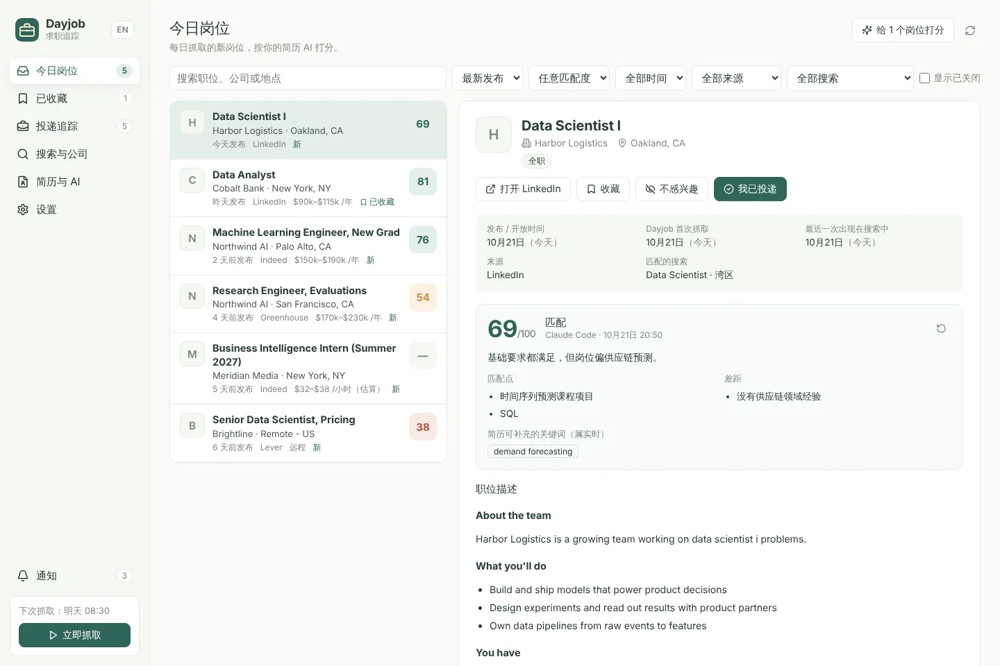
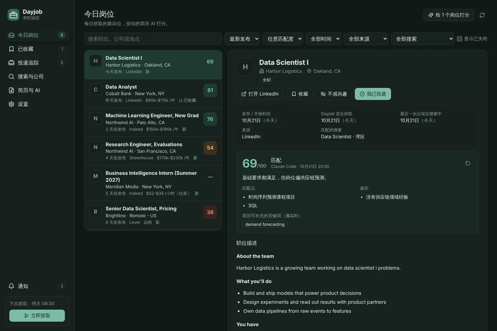
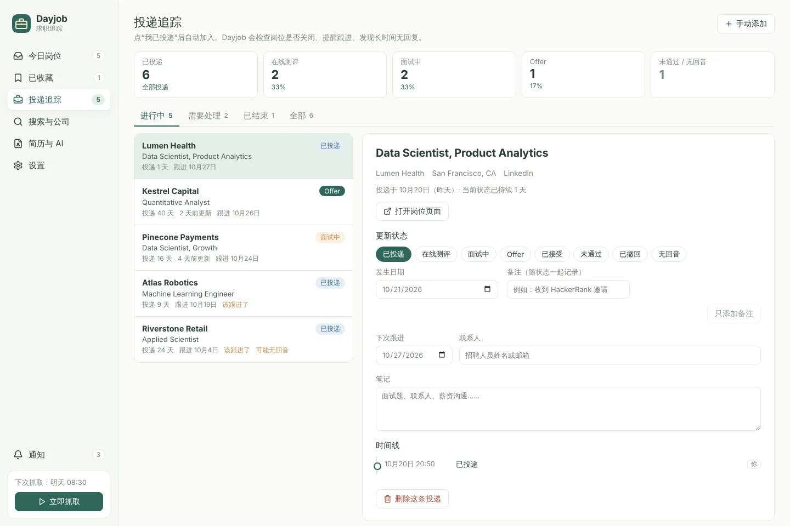
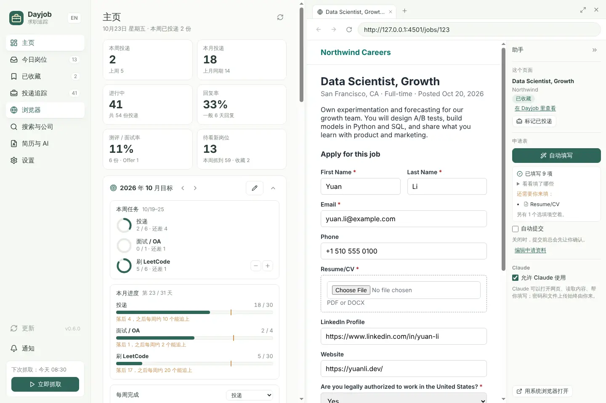

# Dayjob · 求职追踪

**简体中文** · [English](README.en.md)

每天自动抓取你想要的岗位，按你的简历用 AI 打分；点“我已投递”之后，Dayjob 会接着追踪这份申请：提醒跟进、发现长时间无回音、检查岗位是否已经关闭。所有数据都保存在本机的 SQLite 数据库里。

Dayjob 是 [Daylight](https://github.com/Key07211/daylight) 的求职模式，先作为独立项目开发，功能全部完成并验证后再合并进 Daylight（一个按键在 Daylight 和 Dayjob 之间切换）。



> 截图里的公司、岗位和简历都是 `scripts/seed-demo.mjs` 生成的虚构数据。界面跟随系统切换浅色 / 深色，也可以在设置里固定。

<details><summary>深色模式</summary>



</details>

## 功能

| 功能 | 说明 |
| --- | --- |
| 每日抓取 | 每天固定时间（默认 08:30）运行所有搜索；电脑关机错过时，下次打开会补上当天的抓取。也可以随时点左下角的唱片机立即抓取，唱针随进度从外圈走向中心；抓取中再点一下就停止，已经抓到的岗位会留下。 |
| 岗位来源 | LinkedIn、Indeed（参照 JobSpy 的做法直接请求，不需要 Python）；Greenhouse、Lever、Ashby 公司招聘页（官方公开 JSON）；Glassdoor、ZipRecruiter、Google Jobs 通过可选的 Python 版 JobSpy。 |
| 岗位信息 | 标题、公司、地点、远程、薪资、职位类型和级别、完整职位描述；**发布 / 开放时间**、Dayjob 首次抓取、最近一次出现在搜索中、最近一次检查是否关闭。 |
| 过滤 | 每个搜索可设关键词（逗号分隔表示“或”）、地点、发布时间范围、职位类型、只要远程、排除词；跨站重复的岗位自动合并。 |
| AI 打分 | 上传最多 3 份 PDF / Word / 文本简历（比如分别针对数据和软件岗位），每个岗位自动用关键词重合度最高的那份打 0–100 分，列出匹配点、差距和可以补进简历的关键词。默认用本机已登录的 Claude Code（`claude -p`，不需要 API key），也可以用以 ChatGPT 账号登录的 Codex，或自己的 Anthropic / OpenAI API key；模型和推理强度都可以选。打分时可以随时暂停、之后继续；低于 60 分的岗位可以一键剔除。 |
| 按简历推荐 | “搜索与公司”里点“让 AI 推荐”，AI 读你的简历，推荐每天要抓的搜索和值得关注的公司（招聘页会先核实存在），选中的一键添加。 |
| 主页 | 打开就是统计主页：本周 / 本月投递、回复率、测评 / 面试率，每月和每周目标，近 12 周投递趋势、投递漏斗、每日投递热力图、当前状态、各来源效果，以及需要跟进、最近动态和高分还没投的岗位。 |
| 每月目标 | 设定每月投递、面试 / OA 和自己的目标（比如刷题），自动分成每周任务；主页上用图表显示本周任务、本月进度和每周完成情况。 |
| 投递追踪 | 点“我已投递”记下日期和备注，自动进入“投递追踪”。状态：已投递 → 在线测评 → 面试中 → Offer / 已接受 / 未通过 / 已撤回 / 无回音，每次变化都记在时间线上。也可以手动添加不在 Dayjob 里的投递。 |
| 自动追踪 | 投递或状态变化后 N 天（默认 7）提醒跟进；“已投递”超过 N 天（默认 21）没有变化时提示可能无回音；每天检查已投递和已收藏的岗位是否已关闭。 |
| 通知 | 每日汇总（新岗位数、高匹配岗位）、跟进提醒、岗位关闭提醒，Windows 桌面通知 + 应用内通知。 |
| 后台运行 | 关掉窗口后 Dayjob 默认留在托盘里，按时抓取、提醒，Claude 也随时能用；从托盘菜单“退出 Dayjob”才完全关闭。不想让它在后台运行，就在“设置 → 关闭窗口时”取消勾选“关闭窗口后继续在后台运行”，之后关窗口就直接退出，错过的每日抓取在当天下次打开时补上。 |
| 内置浏览器 | 桌面版自带浏览器（左侧“浏览器”），在右侧打开，和主页、投递追踪等页面并排；可以拖动调宽，也可以铺满窗口。多标签页，登录状态只存在本机。右边的助手栏显示这个岗位在 Dayjob 里的状态，可以一键加入 Dayjob、标记已投递。 |
| 自动填写 / 自动提交 | 在“简历与 AI → 申请资料”里填一次姓名、邮箱、电话、链接和常见问题（可以从简历读取），之后在申请表上点 **自动填写**，Dayjob 按每个问题把空着的格子填好，并列出还需要你自己填的必填项。打开 **自动提交** 后，必填项都填好就直接提交（只在这次打开 Dayjob 时有效）。 |
| Claude MCP | Claude Code / Claude Desktop 可以读岗位和简历、写回自己的分析、更新投递状态、使用 Dayjob 浏览器（包括自动填写）、查看和设置每月目标、读取主页统计，共 34 个工具。 |
| 自动更新 | 安装版每天从 GitHub Releases 检查一次新版本（可在设置里关掉），左侧栏“检查更新”也能随时手动检查。有新版本时它会变成圆形下载按钮，下载完点“重启并更新”。 |
| 声音与音乐 | 左侧导航是一排琴键，按下会弹两个音（白天格里格《晨景》，黑夜贝多芬《月光》，也可以选《致爱丽丝》）；落分、投递、开始抓取各有一个音，批量打分结束时“叮”一声。提示音默认关闭，点左上角的喇叭或“设置 → 声音与音乐”打开，连点时一段时间里只响第一下（默认 0.75 秒，可调）。Windows 上可以打开“跟随音乐”：QQ 音乐、网易云音乐、Spotify 等音乐软件放歌时，唱片机显示歌名并跟着转，每页顶部出现跟着音乐跳动的频谱（光柱、点阵、流光三种样式可选，颜色随白天和黑夜），提示音放轻；浏览器里的声音不算。声音只在本机分析，不录音。 |
| 中文 / English | 左上角的 EN / 中 按钮或“设置 → 界面语言”随时切换。通知和托盘菜单跟着切换；AI 分析的语言单独在“简历与 AI”里选。 |



## 下载

直接下载最新的 Windows 版本：

- **[下载安装版（Dayjob-Setup.exe）](https://github.com/Key07211/dayjob---job-tracker/releases/latest/download/Dayjob-Setup.exe)**，装好后从开始菜单或桌面快捷方式打开。
- **[下载免安装版（Dayjob-Portable.exe）](https://github.com/Key07211/dayjob---job-tracker/releases/latest/download/Dayjob-Portable.exe)**，双击直接运行。

每个版本的说明、带版本号的同一份文件（`Dayjob-Setup-x.y.z.exe`、`Dayjob-Portable-x.y.z.exe`）和 SHA-256 校验文件都在 [Releases](https://github.com/Key07211/dayjob---job-tracker/releases/latest) 页面。

程序还没有签名，第一次打开时 Windows 可能提示“Windows 已保护你的电脑”，点“更多信息 → 仍要运行”。从 0.3.0 起安装版会自己更新（左侧栏“检查更新”）；免安装版有新版本时，下载按钮会在浏览器里下载新的免安装版。0.2.0 及更早的版本需要手动下载安装一次 0.3.0，覆盖安装即可。升级或卸载都不会删除 `%APPDATA%\Dayjob` 里的数据。

## 从源码运行

需要 Node.js 22.13 或更新版本（用到内置的 `node:sqlite`）。

```bash
npm install
npm run build
npm start            # 打开 http://127.0.0.1:4318
```

桌面版（托盘、桌面通知、一键连接 Claude）：

```bash
npm run desktop:preview   # 构建界面并用 Electron 打开
npm run package:win       # 打包 Windows 安装版和便携版到 release/
```

开发时 `npm run dev` 会在 5174 端口启动带热更新的界面，并把 `/api` 转发到 4318。

### 数据保存在哪里

| 运行方式 | 数据库位置 |
| --- | --- |
| 桌面版 | `%APPDATA%\Dayjob\data\dayjob.sqlite` |
| `npm start` | 项目里的 `data/dayjob.sqlite`（已加入 `.gitignore`） |
| 自定义 | 设环境变量 `DAYJOB_DATA_DIR`；端口用 `DAYJOB_PORT` |

简历只保存提取出的文字，不保存原文件。Claude API key 以明文保存在本机数据库里，界面和 API 都不会把它返回出来；也可以不保存，改用环境变量 `ANTHROPIC_API_KEY`。

## 第一次使用

1. **简历与 AI**：上传简历（最多 3 份），再在下面的 **申请资料** 里点 **从简历读取**，补上没读到的内容，自动填写会用到。用 Claude Code 打分时，先在终端里安装 Claude Code，运行 `claude` 并输入 `/login` 登录。没登录时“简历与 AI”页会提示，登录后点“重新检测”。
2. **搜索与公司**：点 **让 AI 推荐**，从推荐里挑搜索和公司添加；也可以自己添加一个搜索，例如关键词 `data scientist, machine learning engineer`、地点 `San Francisco Bay Area`、来源 LinkedIn + Indeed、发布时间 3 天内。想盯的公司可以直接粘贴招聘页链接（`boards.greenhouse.io/…`、`jobs.lever.co/…`、`jobs.ashbyhq.com/…`）；关注公司里和搜索关键词、地点匹配的开放岗位都会保留，不受发布时间限制。
3. 点左下角 **立即抓取**。默认抓取完成后会自动打分；想省 Claude 额度，可以在“简历与 AI”里改成只给收藏的岗位打分，或者只在你点的时候打分。
4. 在 **今日岗位** 里看岗位、收藏或标记不感兴趣。要投递时点岗位详情里的“公司申请页”，它会在右侧的浏览器里打开，在申请表上点 **自动填写**。投递后点 **我已投递**（或浏览器助手栏的 **标记已投递**），之后的跟进都在 **投递追踪** 里。
5. 回到 **主页** 看整体进度：投递了多少、哪些该跟进、哪些高分岗位还没投。

## AI 打分

| 方式 | 说明 |
| --- | --- |
| 本机 Claude Code（默认） | 调用 `claude -p`，用你的 Claude 订阅额度，不需要 API key。找不到 `claude` 时可以在“简历与 AI”里填完整路径。 |
| Claude API | 用你自己的 Anthropic API key，默认模型 `claude-opus-5-5`，按用量计费。Opus、Fable、Sonnet 5.5 等模型开启了服务器端回退：如果所选模型拒绝了某次请求，Anthropic 会自动换用备用模型重试一次。 |
| 本机 Codex（ChatGPT） | 调用 `codex exec`，用你 ChatGPT 方案里的 Codex 额度，不需要 API key。先安装 Codex，在终端运行 `codex` 并选择用 ChatGPT 登录。Codex 在只读沙盒和空文件夹里运行，不加载你的 Codex 配置和 MCP。 |
| OpenAI API | 用你自己的 OpenAI API key（Responses API），默认模型 `gpt-6.1-sol`，按用量计费，请求不在 OpenAI 那边保存。 |
| 通过 MCP 让 Claude 分析 | 在 Claude Code 或 Claude Desktop 里说“对照我的简历分析这个岗位”，Claude 读取岗位和简历后用 `dayjob_save_analysis` 把结果写回 Dayjob。 |

### 模型和推理强度

在“简历与 AI”的 **AI 打分** 里选好方式后，**模型** 下拉列出这一方可用的模型，**推理强度** 下拉只列出所选模型支持的档位：

| 方式 | 模型 |
| --- | --- |
| Claude Code / Claude API | Claude Opus 5.5（推荐）、Fable 5.1（最强）、Sonnet 5.5、Haiku 5.5（快、省），以及 Fable 5、Opus 5、Sonnet 5、Opus 4.8 / 4.7 / 4.6、Sonnet 4.6、Haiku 4.5 等旧版。Claude Code 还可以选“跟随 Claude Code 的设置”（默认）。 |
| Codex | GPT-6.1 Sol（推荐）、GPT-6 Astra（最强）、GPT-6 Sol、GPT-6 Luna（快、省），或“跟随 Codex 的设置”。ChatGPT Free 和 Go 方案在 Codex 里只能用 GPT-6 Luna。 |
| OpenAI API | 上面四个 GPT-6 模型，以及 GPT-5.6 Sol / Terra / Luna、GPT-5.5、GPT-5 mini。 |

列表里没有的模型可以选“其他（输入模型 ID）”。推理强度有 低 / 中 / 高 / 很高 / 最高 五档，默认“模型默认”。越高分析越细，但每个岗位更慢、用量更多；Haiku 4.5 没有这个设置。换模型时，新模型不支持的档位会回到“模型默认”。从旧版本升级后打分方式不变：本机 Claude Code 是“跟随 Claude Code 的设置”和“模型默认”，Claude API 保留原来的模型和档位。

每打一个岗位调用一次 AI，会用掉 Claude Code 或 Codex 的额度（或 API 费用）。在“简历与 AI”的 **什么时候打分** 里选：

| 选项 | 什么时候打分 |
| --- | --- |
| 每次抓取后自动打分（默认） | 每次抓取后最多给 40 个岗位打分（可调），先打新岗位，再补之前没打分的。 |
| 只给收藏的岗位打分 | 收藏一个岗位时给它打分，抓取时只补打还没打分的收藏岗位。 |
| 只在我点的时候打分 | 在岗位详情点 **AI 打分**，或在今日岗位里勾选几个，点右上角 **给选中的 N 个岗位打分**。 |

0.2.0 及以前关掉了“抓取后自动打分”的，升级后是“只在我点的时候打分”。

打分进行时，左下角会显示“AI 正在打分 3/12”和 **暂停打分** 按钮。点暂停后，正在打的那个岗位立刻停下（Claude Code 或 Codex 进程会一起结束，不再消耗额度），剩下的岗位留着；暂停期间新抓到的岗位、手动点的打分也都先排着。点 **继续打分** 接着打，这期间被标为不感兴趣或已投递的岗位会跳过。关掉 Dayjob 再打开，仍然是暂停状态。

**今日岗位** 右上角的 **剔除低于 60 分的岗位** 会把所有低于 60 分的新岗位一次移到“不感兴趣”，已收藏和已投递的不动，还没打分的也不动。移完可以点 **撤销**。

有多份简历时，Dayjob 先在本机比较岗位和每份简历的关键词（标题里的词权重更高，忽略 “experience”“team” 和平等就业声明这类每个岗位都有的词），选重合度最高的那份交给 AI 打分。岗位详情里能看到用了哪份简历、重合了哪些词，以及每份简历的重合度。上传或删除简历后，岗位会重新选简历，选到的简历变了就会重新打分。

## 按简历推荐搜索和公司

在 **搜索与公司** 页点 **让 AI 推荐**（可以先写补充偏好，比如“只看湾区和远程、需要 H-1B 担保”）。AI 用“简历与 AI”里选的方式和模型运行（本机 Claude Code 或 Codex 会用你的额度，一次大约一分钟），读完所有简历后给出：

- 最多 6 个搜索：职位关键词、地点、要排除的级别词（比如应届简历排除 Senior / Staff），以及适合哪份简历；
- 最多 10 家公司：只推荐用 Greenhouse、Lever、Ashby 招聘的公司。Dayjob 会逐个请求它们的招聘页，不存在的直接去掉，并显示目前的公开岗位数。

推荐不会自动加入，点 **添加** / **关注** 的才会；也可以先编辑再添加。选好后点底部的 **选好了，关闭推荐**（或右上角的 ✕）把推荐收起来。最近一次推荐会保存下来，关掉后点 **重新打开** 还能再看；重新推荐出来的结果会直接显示。

## 主页

打开 Dayjob 先看到的是 **主页**，把投递、追踪和目标放在一页：


| 部分 | 内容 |
| --- | --- |
| 顶部数字 | 本周投递（对比上周）、本月投递（对比上月同期）、进行中的投递、回复率和一般几天回复、进入测评或面试的比例和 Offer 数、待看的新岗位。 |
| 每月目标 | 本周任务、本月进度、每周完成，见下一节。 |
| 近 12 周投递 | 每周投递数和进入测评 / 面试数，虚线框是每周的投递目标。鼠标移到某一周看具体数字，右上角可以切换成表格。 |
| 投递漏斗 | 每份投递走到过的最远一步：投递 → 在线测评 → 面试 → Offer，以及每一步的转化率；后来被拒的也按走到过的阶段算。 |
| 每日投递 | 近 12 周每天投了几份，颜色越深越多，还会显示连续投递了几天。 |
| 当前状态 | 进行中和已结束的投递各有多少，分别在哪个状态。 |
| 来源效果 | LinkedIn、Indeed、公司招聘页等各投了多少、多少进入测评或面试、拿到几个 Offer。手动添加的投递单独算一行。 |
| 需要跟进 / 最近动态 / 高分还没投 | 点一行直接打开对应的投递或岗位。 |

## 每月目标

**主页** 上是本月目标。点 **设定目标**，填这个月想完成的数量：

| 目标 | 怎么计数 |
| --- | --- |
| 投递 | 自动：点“我已投递”或手动添加投递时，按投递日期计入。 |
| 面试 / OA | 自动：投递追踪里状态改为“在线测评”或“面试中”时计入，同一份投递的测评和面试各算一次。 |
| 自定义（比如刷题、联系校友） | 手动：在“本周任务”里点 **+1** 打卡，点错了点 **−1**。 |

每周从周一到周日，月初和月底不满一周的按天数算。每周任务等于月目标乘以这一周在本月的天数占比，四舍五入后各周加起来正好等于月目标。比如 2026 年 10 月投递 40 份，每周任务是 5 · 9 · 9 · 9 · 8。

- **本周任务**：每个目标这周完成了几个、还差几个。
- **本月进度**：完成数和月目标，橙色竖线是按天数今天应该到的位置；落后时会提示之后每周大约要完成多少才能追上。
- **每周完成**：柱子是每周完成数，虚线框是每周任务。

左右箭头可以查看上个月或提前设定下个月。新的一个月开始时会自动沿用上个月的目标（进度从 0 开始），改掉或清空都可以。不想占地方时点右上角收起。

## 连接 Claude（MCP）

桌面安装版：**设置 → 连接 Claude**，一键写入 Claude Code（`~/.claude.json`）和 Claude Desktop 的配置，写入前会备份原文件，只增加或更新 `dayjob` 这一项。

从源码运行时，在终端里执行（把路径换成你的 Dayjob 文件夹）：

```bash
claude mcp add dayjob -s user -e DAYJOB_URL=http://127.0.0.1:4318 -- node <Dayjob 文件夹>/integrations/mcp-server.mjs
```

Claude 需要 Dayjob 保持运行。连接后可以这样说：

> 看看 Dayjob 今天有哪些 80 分以上的岗位，按匹配度排一下。
>
> 我刚投了 Lumen Health 的 Data Scientist，帮我在 Dayjob 里标记已投递。
>
> 根据我 Gmail 里的面试邀请，更新 Dayjob 的投递状态。

| 工具 | 作用 |
| --- | --- |
| `dayjob_status` | 运行状态、下次抓取时间、简历和打分状态 |
| `dayjob_list_postings` / `dayjob_get_posting` | 查岗位（按分数、来源、时间筛选）和详情 |
| `dayjob_list_resumes` / `dayjob_get_resume` | 列出简历；读某个岗位匹配到的那份简历（或指定的一份） |
| `dayjob_save_analysis` / `dayjob_score_posting` | 写回 Claude 自己的分析、触发打分 |
| `dayjob_set_posting_status` / `dayjob_add_posting` | 收藏、不感兴趣、手动添加岗位 |
| `dayjob_mark_applied` / `dayjob_add_application` | 标记已投递、添加 Dayjob 之外的投递 |
| `dayjob_list_applications` / `dayjob_get_application` / `dayjob_update_application` | 查看和更新投递状态、备注、跟进日期 |
| `dayjob_list_searches` / `dayjob_save_search` / `dayjob_follow_company` / `dayjob_run_search` | 管理搜索、关注公司、立即抓取 |
| `dayjob_list_notifications` | 最近的提醒 |
| `dayjob_get_goals` / `dayjob_set_goal` / `dayjob_log_goal_progress` | 查看每月目标和每周任务、设定目标、给自定义目标打卡 |
| `dayjob_get_dashboard` | 读取主页上的统计（每周投递、漏斗、回复率、各来源效果、需要跟进的投递等），适合让 Claude 做每周复盘 |
| `dayjob_browser_open` / `dayjob_browser_read` / `dayjob_browser_screenshot` | 在 Dayjob 浏览器里打开网页、读文字和可操作的元素、截图 |
| `dayjob_browser_click` / `dayjob_browser_type` / `dayjob_browser_select` / `dayjob_browser_press_key` | 点击、输入、选择下拉项、按键 |
| `dayjob_browser_scroll` / `dayjob_browser_navigate` / `dayjob_browser_tabs` | 滚动、前进后退刷新、切换和关闭标签页 |
| `dayjob_browser_autofill` | 用申请资料填好当前申请表（和助手栏的“自动填写”一样），告诉 Claude 填了什么、还缺哪些必填项；不会提交 |

通过 MCP 做的修改会在时间线上标为“Claude”。

## 内置浏览器

桌面版左侧的 **浏览器** 是 Dayjob 自带的浏览器，和 Chrome、Edge 分开。点它会在窗口右侧打开，左边照常显示主页、投递追踪或其他页面，边看岗位边记录：



- 拖动两栏中间的分隔条调宽度（双击恢复默认，也可以用键盘左右方向键）；右上角的按钮切换 **铺满窗口** 和 **并排显示**，× 收起浏览器，标签页会保留。窗口太窄时会自动铺满。
- 在里面登录 LinkedIn、Indeed、Handshake 或公司招聘网站，登录状态和 Cookie 只保存在本机的 Dayjob 数据里（**设置 → Dayjob 浏览器** 可以一键清除）。
- 岗位详情里的“打开 LinkedIn”“公司申请页”会在这里打开；助手栏底部的 **用系统浏览器打开** 用 Chrome、Edge 打开当前页。

浏览器右边是 **助手** 栏（`»` 可以收起成一条窄边）：

| 部分 | 作用 |
| --- | --- |
| 这个页面 | 当前网页已经在 Dayjob 里时，显示职位、公司和状态，可以 **在 Dayjob 里查看** 或 **标记已投递**。还没有时点 **加入 Dayjob**：读取网页里的标准岗位数据（schema.org JobPosting，大多数招聘网站都有）或正文，确认后收藏，或者直接 **保存并标记已投递**。 |
| 自动填写 | 按申请表上每个问题的文字，用 **申请资料** 填进空着的格子：姓名、邮箱、电话、地址、LinkedIn / GitHub / 个人网站、学校和工作、工作许可、签证担保、愿意搬迁、期望薪资、最早入职时间、从哪里看到岗位等，也会选下拉框和单选项。已经填了的格子不会改。完成后列出填了哪些，以及还需要你自己填的必填项（比如上传简历）。公司官网里嵌入的申请表（比如嵌在页面里的 Greenhouse 表单）也能填。 |
| 自动提交 | 默认关闭，关闭时任何提交都要你自己点或先确认。开启时会再确认一次；开启后，自动填写在必填项都填好时直接点提交，并确认页面显示申请已收到，Claude 点提交时也不再先问你。每次打开 Dayjob 都会恢复为关闭。提交成功后点 **标记已投递** 就进入投递追踪。 |
| Claude | **允许 Claude 使用** 取消勾选后，Claude 就不能再打开或操作这个浏览器。 |

自动填写不会碰密码、验证码、签名、推荐人和紧急联系人这类格子；性别、种族、退伍军人、残障这类自愿填写的问题默认选“不愿透露”，在申请资料里取消这个勾选后会留给你自己选。申请资料只保存在本机。

连接 Claude 后可以这样说：

> 用 Dayjob 浏览器打开这个岗位的申请页，先自动填写，再按我的简历回答剩下的问题，提交前给我看一下。

Claude 能做什么、不能做什么：

- 能打开网页、阅读文字、截图、点击、输入、选择下拉项、切换标签页，也能用 `dayjob_browser_autofill` 先把申请资料填进去。Dayjob 窗口里看得到它在做什么（显示“Claude 正在操作”）。
- 点击“提交”“发送”“确认”“删除”之类的按钮，或在多项表单里按回车，会先在 Dayjob 里弹出确认，你点 **允许** 才会执行，2 分钟没回应就取消。只有你打开了 **自动提交** 时才会直接执行，Claude 也会被告知这一点。
- 不会输入密码、银行卡号或验证码，也不会替你上传文件（简历请自己选）。网页上的文字只当作资料，不当作指令。

有些网站不允许在内置浏览器里用 Google 账号登录；遇到这种情况，用邮箱密码登录，或点 **用系统浏览器打开**。

## JobSpy（可选）

Glassdoor、ZipRecruiter 和 Google Jobs 需要 Python 版 [JobSpy](https://github.com/speedyapply/JobSpy)：

```bash
pip install python-jobspy
```

然后在 **设置 → JobSpy** 里确认 Python 命令（Windows 默认 `python`），保存后会重新检测。LinkedIn、Indeed 和公司招聘页不需要 Python。

## 抓取的注意事项

- LinkedIn 和 Indeed 会限制频繁请求。Dayjob 每页之间随机等待几秒、遇到 429 会退避重试，被限制时这次抓取标为“部分完成”，其他来源照常。每天一次、每个搜索几十个结果通常没问题；不建议把间隔调得很短或一次抓几百个。
- 检查岗位是否关闭时，当天搜索里还能看到的岗位直接算作开放，不再单独请求。有些网络打开 Indeed 的岗位页会被拒绝（HTTP 401），这时 Dayjob 无法判断 Indeed 岗位是否已关闭，只能靠它是否还出现在搜索里；其他来源照常检查。
- Glassdoor、ZipRecruiter、Google Jobs 依赖 JobSpy 的实现，网站改版后可能需要更新 JobSpy。
- 请遵守各网站的使用条款，只用于个人求职。

检查各个来源在你的网络环境下是否正常：

```bash
npm run live-check                          # LinkedIn、Indeed、Greenhouse、Lever、Ashby
npm run live-check -- --pipeline            # 再跑一遍完整流程（临时数据库，跑完删除）
npm run live-check -- --score 简历.pdf      # 再用 Claude Code 给一个岗位打分
npm run live-check -- --jobspy              # 再试 Python JobSpy
```

## 测试

```bash
npm test
```

测试不访问任何网站：抓取用保存下来的页面（`tests/fixtures/`），AI 打分用假的 provider，MCP 用内存连接。

桌面版的冒烟测试（`electron . --smoke-test <结果.json>`，打包检查里每个安装包都会跑）还会在内置浏览器里打开一个本机的申请表（其中一部分嵌在另一个来源的 iframe 里），自动填写并检查每个值，确认再填一次不会改动已填的内容；然后确认 Claude 点“提交”前会先请用户允许，打开自动提交后自动填写会直接提交并认出“申请已收到”的页面。安装版的检查还会从本机模拟一个“9.9.9”新版本：确认左侧栏出现圆形下载按钮、点它下载并校验安装包（不会真的安装）。

想看界面但不想抓取，可以生成一份虚构数据：

```bash
node scripts/seed-demo.mjs ./demo-data
DAYJOB_DATA_DIR=./demo-data npm start
```

## 发布新版本

每个 PR 和每次推送到 main，GitHub Actions 都会在 Windows 上跑测试、打包安装版和免安装版，并把这三种形态（解压版、静默安装后的安装版、免安装版）各启动一遍，同时检查打包后的 Claude MCP 连接。

发布时把 `package.json` 里的 `version` 改成新版本号（例如 `0.2.0`）并合并到 main。如果这个版本还没有发布过，工作流会用刚验证过的文件创建 `v0.2.0` 的 Release。不需要手动推送 tag，也不要在 GitHub 网页上手动发布。

在自己电脑上检查打包结果：

```bash
npm run package:win
powershell -ExecutionPolicy Bypass -File scripts/verify-windows-build.ps1 -Version 0.7.0
```

## 目录

```
server/            本机 HTTP 服务（只监听 127.0.0.1）
  jobs/scrapers/   LinkedIn、Indeed、公司招聘页、JobSpy 桥接
  jobs/scoring/    Claude Code / Claude API / Codex / OpenAI API 打分，models.mjs 是模型和推理强度列表
  jobs/            SQLite、搜索、追踪、每日调度、简历匹配、Claude 推荐、每月目标、主页统计
integrations/      Claude MCP 服务器
desktop/           Electron 主进程、托盘、Claude 一键连接、内置浏览器和自动填写、自动更新
src/               React 界面
tests/             node:test 测试和抓取样本
scripts/           演示数据、真实网站检查、Windows 打包检查
.github/workflows/ Windows 打包、验证和发布
```

## 许可

抓取逻辑参考了 [JobSpy](https://github.com/speedyapply/JobSpy)（MIT），见 [THIRD_PARTY_NOTICES.md](THIRD_PARTY_NOTICES.md)。
